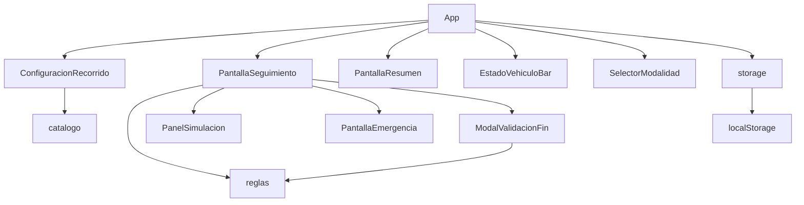
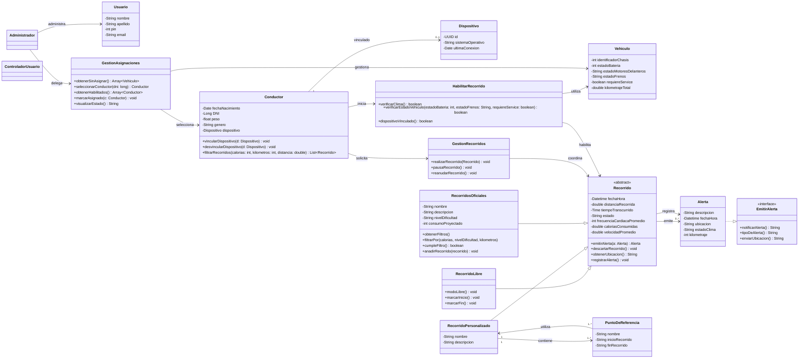
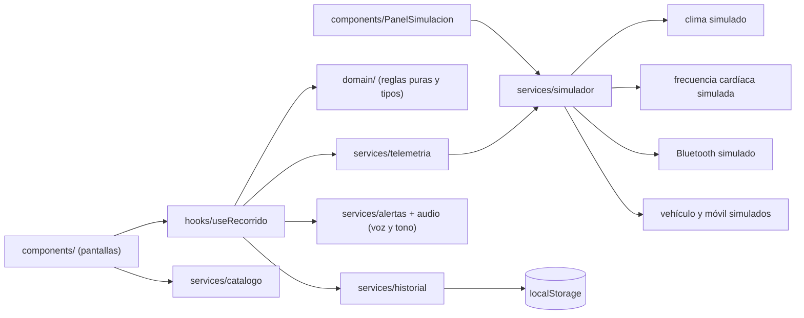
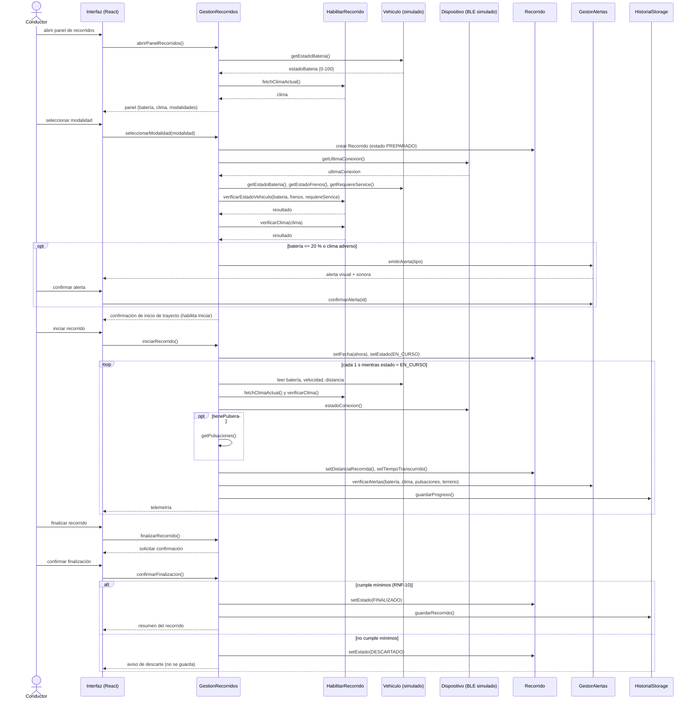
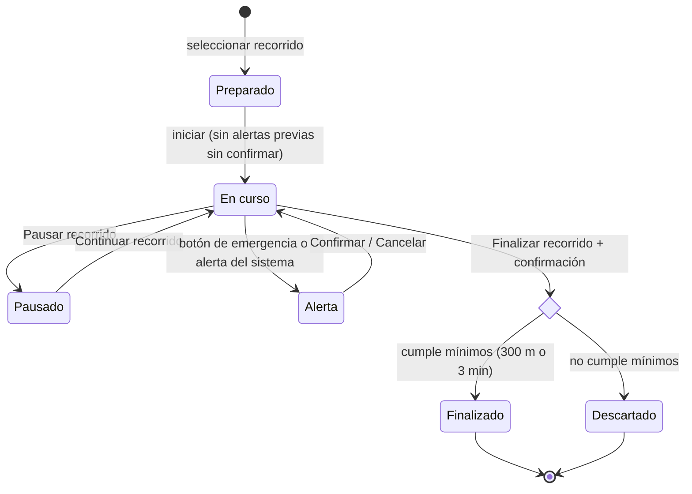
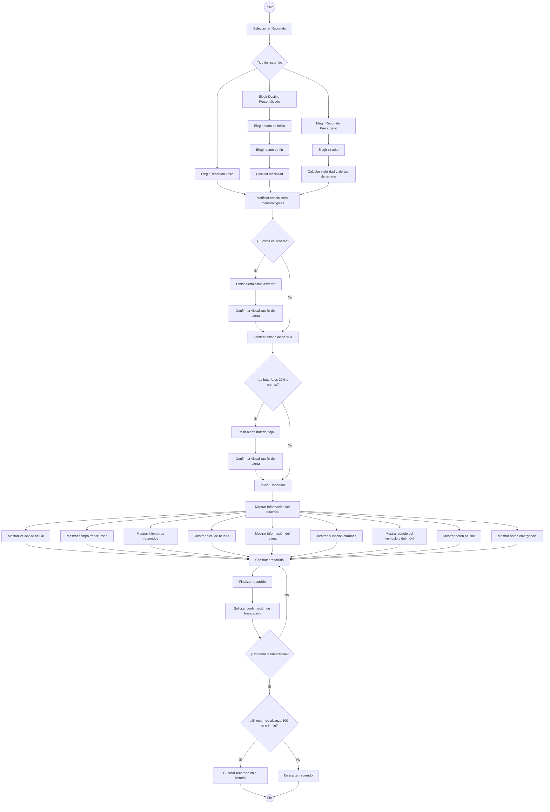
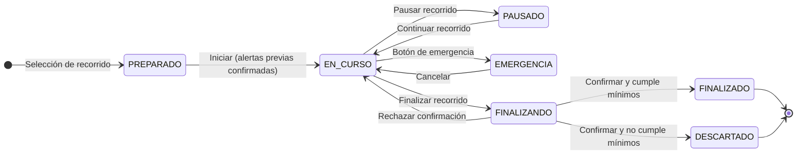

# RFC Técnico: Spec 1 - Realizar Recorrido / Prototipo

## Prototipo web responsive de la app del conductor para el CU N.º 1 "Realizar recorrido" (con hardware y servicios simulados)

| Campo               | Detalle                                                         |
| :------------------ | :-------------------------------------------------------------- |
| **Título**          | RFC-SPEC 1: Realizar recorrido                                  |
| **Proyecto**        | Sistema de triciclos UNTDF / Nicolas Easdale                    |
| **Materia / Grupo** | Ingeniería de Software I — Grupo 1                              |
| **Integrantes**     | Cerezo Marcos, Folk Walter, González Gabriela, Tamargo Jeremías |
| **Fecha**           | 18/11/2026 |
| **Versión**         | 0.5 (D-28 propuesto; D-27 aprobado) |
| **Estado**          | Aprobado |
| **Fecha de actualización** | 19/11/2026 |
| **Revisores**       | D’Uva Ivan, Lemos José, Moyano Ezequiel                         |

**Spec de origen:** [SPEC actualizado: Realizar un recorrido](docs/SPEC_REALIZAR_RECORRIDO) y [CU N.º 1](docs/CASO_DE_USO_REALIZAR_RECORRIDO), leídos completos el 18/11/2026. No tienen fecha ni versión interna. Sus 18 criterios de aceptación se identifican aquí como CA-01 a CA-18 por orden de aparición, sin modificar la fuente.

**Fuente complementaria de requisitos:** `docs/Entrega 4.pdf`, capítulo 1, páginas 3–8 (numeración del PDF), consultado solo para los RF/RNF aplicables al CU-01. Su SPEC de páginas 11–14 es anterior al SPEC actualizado de `docs/SPEC_REALIZAR_RECORRIDO`; no lo reemplaza ni amplía el alcance a otros casos de uso. RF-18 proviene del SPEC actualizado (CA-18), pues el catálogo del PDF llega a RF-17.

**Diagramas de referencia comprobados:** `docs/diagrama de clases.svg`, `docs/diagrama secuencia.svg`, `docs/Diagrama_Actividad.svg`, `docs/maquinas-estado.svg`. Se revisaron las etiquetas de las vistas SVG exportadas de draw.io. No existe `docs/diagramas/` ni `docs/documento_de_prototipo.pdf` mencionado en AGENTS.md. No hay exportación separada de comunicación; las páginas adicionales del XML incrustado no se presuponen versiones vigentes independientes.

**Base de revisión:** evolución del contenido v0.2 existente al inicio, sin restaurar el RFC de la implementación. Inspección estática de todos los archivos de `src/`, pruebas, dependencias, configuración y registro histórico. No se ejecutaron tests, build ni validación funcional en PLAN. Las observaciones de código no certifican ejecución. Durante PLAN se mantuvieron D-01 a D-04 y D-11 decididas y el resto como propuestas; la aprobación humana posterior queda registrada en 9.1. Las observaciones de PLAN se conservan como línea de base histórica.

---

## 1. Alcance del Prototipo y Enfoque

El objetivo es cubrir el CU N.º 1 de punta a punta desde la app del conductor, refactorizando la implementación existente. La tabla describe responsabilidades objetivo, no módulos cuya existencia se haya comprobado; el contraste real figura en 1.3 y 3. Todo hardware y servicio externo permanece simulado.

| Componente                             | Real / Simulado / Fuera de alcance | Nota                                                                                                                                                                         |
| :------------------------------------- | :--------------------------------- | :--------------------------------------------------------------------------------------------------------------------------------------------------------------------------- |
| Interfaz de usuario                    | Real                               | Web responsive en español (RNF-06). Pantallas: panel de recorridos, alertas previas, recorrido en curso, pausa, emergencia, confirmación de finalización y resumen.          |
| Gestor de recorridos                   | Real                               | Coordinación hoy repartida entre App y PantallaSeguimiento; extracción mínima propuesta en 3.1.                                                                                                        |
| Gestor de modalidades                  | Real                               | Recorrido libre, destino personalizado y recorrido precargado (RNF-20).                                                                                                      |
| Catálogo de recorridos y puntos        | Simulado                           | Datos de ejemplo existentes en `src/services/catalogo.ts` (no son circuitos oficiales de la UNTDF). La carga de recorridos por el administrador (CU N.º 9) está fuera de alcance.                       |
| Validador de viabilidad                | Real                               | Funciones de dominio y catálogo: reglas de batería (RNF-09), clima (RNF-14) y estimaciones (RF-06). Las constantes de consumo y calorías son de simulación y no están calibradas.       |
| Gestor de telemetría                   | Real                               | Lee las fuentes simuladas cada 1 s y publica velocidad, tiempo, distancia, batería, clima y pulsaciones.                                                                     |
| Gestor de alertas                      | Real                               | Alertas visuales de batería, clima, terreno y frecuencia cardíaca, con confirmación del conductor.                                                                           |
| Alertas sonoras (audio)                | Real                               | Web Audio API (pitido) + Web Speech API (mensaje en voz en español), según RNF-11.                                                                                           |
| Gestor de conexión Bluetooth           | Simulado                           | Contrato de conexión simulada con reintentos automáticos propuestos (RNF-22). No se usa BLE real (RNF-04 queda como interfaz simulada).                                                       |
| Simulador de vehículo                  | Simulado                           | `SimuladorVehiculo`: velocidad, batería, distancia, frenos, motores delanteros, asistencia híbrida, odómetro y service.                                                       |
| Simulador de clima                     | Simulado                           | `SimuladorClima`: condiciones controlables desde el panel de simulación.                                                                                                      |
| Simulador de frecuencia cardíaca       | Simulado                           | `SimuladorFrecuenciaCardiaca`: reemplaza al smartwatch o banda.                                                                                                               |
| Perfil del conductor / sesión / vínculo | Simulado                          | Precondición del CU: sesión iniciada y vehículo vinculado se asumen. Hoy solo existen smartwatchVinculado y BPM en estado React; perfil físico configurable pendiente D-05/D-12, sin agregar datos personales injustificados.                |
| Gestor de emergencias                  | Simulado                           | Solo la pantalla de emergencia con el botón "Cancelar" (non-goal de la spec: el procedimiento completo del CU N.º 8 queda afuera).                                           |
| Gestor de historial                    | Real (solo registro)               | Se guardan los recorridos válidos. La consulta y gestión del historial es non-goal de la spec.                                                                               |
| Persistencia                           | Real (local)                       | `localStorage` del navegador: datos del recorrido en curso (RNF-07) e historial. No hay base de datos ni servidor.                                                            |
| Filtro de recorridos (CU N.º 2)        | Fuera de alcance                   | Es otra spec. Ver decisión D-02 en 9.1.                                                                                                                                       |
| Backend / API / plataforma web admin   | Fuera de alcance                   | La lógica corre en el navegador.                                                                                                                                              |

### 1.1 Alternativas evaluadas

| Criterio           | Opción A: Frontend con React + TypeScript (Web Responsive)                                                                                                   | Opción B: Frontend con React Native + Expo (Móvil)                                                                                                                      |
| ------------------ | ------------------------------------------------------------------------------------------------------------------------------------------------------------ | ----------------------------------------------------------------------------------------------------------------------------------------------------------------------- |
| Complejidad        | Baja. Permite desarrollar y ejecutar el prototipo directamente en un navegador web.                                                                          | Media. Requiere configurar un entorno de desarrollo móvil y realizar pruebas en dispositivos o emuladores.                                                              |
| Cobertura del Spec | Permite implementar los flujos funcionales del CU crítico mediante una interfaz adaptable a dispositivos móviles. Las integraciones con hardware se simulan. | Permite implementar los flujos del CU crítico en una aplicación móvil, respetando el entorno previsto originalmente. Las integraciones con hardware también se simulan. |
| Riesgo / tiempo    | Menor riesgo técnico y menor tiempo de desarrollo, facilitando la implementación y validación del prototipo.                                                 | Mayor riesgo técnico y tiempo de configuración, debido a las particularidades del desarrollo móvil.                                                                     |

**Decisión:** Opción **A, frontend con React + TypeScript**, como prototipo web responsive.

Motivo: se prioriza reducir la complejidad técnica y los tiempos de desarrollo para poder implementar, demostrar y validar las funcionalidades del CU N.º 1 (caso de uso crítico).

**Desvíos respecto del sistema completo (declarados):**
- RNF-03 (desarrollo nativo en Android): el prototipo es web responsive.
- RNF-04 (BLE): la comunicación con la centralita se simula detrás de una interfaz, sin hardware real.

### 1.2 Requisitos fuera del alcance de esta spec

Se mantienen fuera de alcance RF-08 y RNF-17 (límite de velocidad; el control QA actual admite hasta 30 km/h, sin afirmar un límite implementado de 24), RNF-13 y RNF-25 (service obligatorio), RNF-23 (carga automática), RNF-24 (antirrobo), RNF-26 (peso) y la navegación GPS paso a paso. RNF-27 sí cubre alertas de terreno en precargados. **RNF-15 vuelve al alcance porque el SPEC actualizado lo incluye**; incluye modos claro/oscuro y predominio gráfico 70% frente a un máximo de 30% de texto (Entrega 4, p. 7). D-23 registra el método de áreas y la paleta neutra aprobados por el equipo.

### 1.3 Contraste SPEC ↔ UML ↔ RFC ↔ implementación

**Instantánea de PLAN, conservada para justificar las tareas:** las brechas de esta tabla no describen todas el estado posterior a BUILD. El avance real y la evidencia están en secciones 8.4 y 10.

Requisitos incluidos por el SPEC: CU-01; RF-04, RF-06, RF-07, RF-09, RF-14, RF-15, RF-18; RNF-04, RNF-05, RNF-06, RNF-07, RNF-09, RNF-10, RNF-11, RNF-14, RNF-15, RNF-20, RNF-22 y RNF-27. Se normaliza el guion respecto del subrayado de la fuente. RNF-21 no está listado: se conserva solo como referencia histórica de v0.2, sin añadir alcance.

| Requisito / criterios | Evidencia de comportamiento | Brecha y propuesta |
| :--- | :--- | :--- |
| CU-01 / RF-04 / RNF-20; CA-01/02 | App, SelectorModalidad y ConfiguracionRecorrido seleccionan tres modalidades y navegan al seguimiento. | Conservar. EstadoVehiculoBar muestra valores constantes independientes del seguimiento: compartir fuente simulada. |
| RF-06; CA-03 | Entrega 4, p. 3, incluye distancia, tiempo de viaje, consumo y kcal para precargados. Catálogo y UI ya los calculan; SPEC/CA-03 agrega personalizados. | Parcial: batería fija en 80, selección inválida puede iniciar. Conservar cálculo y tiempo estimado; cubrir ambas modalidades conforme SPEC actualizado y documentar diferencia de fuente en D-26. Política por autonomía pendiente D-21. |
| RF-07 / RNF-11 / RNF-14; CA-04/08/09/10 | reglas.ts detecta batería/clima/pulso; seguimiento crea y confirma banners. | Faltan alertas previas, pitido/voz y disparo de terreno. Confirmar elimina banner, pero reaparece al siguiente tick si persiste condición. Confirmar batería desactiva asistencia sin respaldo funcional (D-22). |
| RF-09; CA-13/14 | Entrega 4, p. 4: botón de emergencia ante accidente. PantallaEmergencia y botón existen. | Cobertura acotada por SPEC y D-03: pantalla de prueba persistente hasta Cancelar, sin procedimiento completo ni reporte externo. Corregir salidas alternativas y congelamiento de métricas. TC-13/14. Definición ya recuperada (D-18). |
| RF-14; CA-05/11 | Bluetooth booleano visible; EstadoVehiculoMovil declara batería móvil. | Falta mostrar batería móvil y distinguir reintento/datos obsoletos. Barra fija puede contradecir seguimiento. |
| RF-15; CA-05 | Asistencia, motores y frenos visibles en seguimiento. | Falta odómetro; motores/frenos fijos OK, sin controles QA. Reutilizar vista y conectar datos compartidos. |
| RF-18; CA-18 | PantallaSeguimiento muestra frecuenciaCardiaca en bpm solo con smartwatchVinculado. PanelSimulacion permite variar vínculo y BPM. | Base presente por inspección; falta prueba integrada de visibilidad y actualización. TC-09 prueba alerta, no toda visualización: agregar TC-26. Sin hardware real. |
| RNF-04 / RNF-22; CA-11 | Booleano alternable y banner que dice “Reintentando”. | No hay reintentos programados ni aviso de dato obsoleto; constantes sin uso. Telemetría sigue acumulándose como conectada. |
| RNF-05 / RNF-06; CA-06/07 | Entrega 4, p. 5: interfaz hipergráfica, fuentes ≥20pt, íconos centrados ≥20vh, sin colores u objetos en movimiento; idioma español. UI actual tiene español, pero abundan 0.75–1.4rem. | Español reutilizable; tamaños actuales no satisfacen mínimos documentados. Adaptar texto de la UI del conductor e íconos, sin limitar arbitrariamente la regla a una métrica/ícono. Confirmar interpretación de colores en D-23, manteniendo restricciones contra movimiento. TC-06/07. |
| RNF-07 | storage.ts implementa funciones de progreso, sin llamadas desde flujo. | Integrar guardado y limpieza; errores solo en consola. Operación sin red tras cargar no demuestra arranque offline (sin caché garantizada/service worker). D-15. |
| RNF-09; CA-04/08 | bateriaBaja usa ≤20 y tiene pruebas de frontera. | Conservar regla, agregar evaluación previa. Resolver < frente a ≤ y confirmación frente a prohibición de inicio (D-06). |
| RNF-10; CA-15/16/17 | cumpleMinimos usa ≥300m O ≥180s; modal la usa; App guarda por callback válido. | Conservar regla y modal. Descarte vuelve al panel sin aviso posterior; inicio se fecha al terminar, batería inicial fija, promedio cardíaco es última lectura. Corregir datos y probar integración. |
| RNF-15 | Entrega 4, p. 7: modo claro y oscuro; 70% de pantalla con elementos visuales (íconos/botones), máximo 30% texto. UI actual tiene estilos claros fijos y abundante texto. | Falta modo oscuro y demostrar proporción visual. Adaptar componentes existentes con estilos compartidos y un control simple de tema antes del recorrido, sin dependencias. TC-27; método de medición y color pendientes D-23. |
| RNF-27; CA-08 | Catálogo muestra alertaTerreno textual al seleccionar circuito. | No dispara aviso durante marcha. Agregar posiciones simuladas reproducibles solo para precargados. |
| CU-01; CA-12/13/14/15 | Pausa congela intervalo; emergencia muestra componente; modal confirma guardar/descartar. | Falta modal de pausa; controles permiten acciones inválidas. Emergencia detiene métricas contra D-03 y permite salir por Reanudar sin Cancelar. Máquina pura no integrada. |

El diagrama de actividad disponible **ya usa “300m o 3min”**: la discrepancia AND→OR de v0.2 está resuelta en esa vista. Máquinas-estado aún etiqueta descarte por tiempo y usa ALERTA; código usa EMERGENCIA/FINALIZANDO. Secuencia devuelve batería boolean en primera consulta, clases la modela int y código number. Las diferencias se tratan en 9.1 sin alterar UML durante PLAN.

---

### 1.4 Requisitos del CU-01 precisados con Entrega 4

Se resumen únicamente los requisitos del SPEC actualizado; el PDF complementa sus definiciones, sin incorporar funcionalidades de otros CU. Las páginas son ubicaciones verificadas, no aprobación de propuestas de diseño.

| Requisito | Definición aplicable / referencia |
| :--- | :--- |
| RF-04 | Selección de viaje o modalidad (p. 3); tres modalidades según RNF-20 (p. 7). |
| RF-06 | Estimaciones de distancia, tiempo, batería y kcal en precargados (p. 3). SPEC/CA-03 extiende a personalizados; conservar ambos conforme fuente principal, diferencia D-26. |
| RF-07 | Alertas sonoras durante marcha por batería, cambios drásticos del clima y pulso elevado con reloj vinculado (p. 3). |
| RF-09 | Botón de emergencia ante accidente (p. 4), acotado por SPEC/CA-13/14 a pantalla de prueba y Cancelar; sin implementar CU-08 completo. |
| RF-14 / RF-15 | Durante marcha: sincronización y batería móvil; asistencia híbrida, odómetro, motores delanteros y frenos (p. 4). |
| RF-18 | Mostrar BPM en tiempo real con pulsera/reloj vinculado (SPEC actualizado, CA-18). No figura en catálogo del PDF; no eliminarlo por esa diferencia temporal. |
| RNF-04 | BLE entre móvil y centralita (p. 5); simulación declarada para el prototipo según D-11. |
| RNF-05 / RNF-06 | Fuentes no menores a 20pt, íconos centrados de mínimo 20vh, restricción de colores/objetos en movimiento; idioma español (p. 5). Se conservan medidas literales. Interpretación de color resuelta en D-23 mediante paleta neutra estática. |
| RNF-07 | Guardar datos del recorrido en memoria local durante el recorrido (p. 6). El texto no exige arranque offline ni recuperación tras cerrar; no añadir esas funcionalidades por el título “Offline-first”. |
| RNF-09 | Antes de iniciar, carga mayor a 20%; si no se cumple emitir alerta (p. 6). Exactamente 20% requiere alerta. CU 4.A permite asumir inicio al confirmar; diferencia con UML <20 en D-06, sin inventar bloqueo absoluto. |
| RNF-10 | Guardar con al menos 300m o 3min (p. 6). OR inclusivo, coherente con D-01 y reglas existentes. |
| RNF-11 | Alertas importantes de clima, batería y pulsaciones mediante voz/audio durante recorrido (p. 6). D-04 conserva pitido más voz como decisión del equipo. |
| RNF-14 | Avisar al bajar batería a 20%; al iniciar con escarcha/hielo; pulso elevado detectado por smartwatch (pp. 6–7). Escarcha/hielo no es opcional; lluvia/viento elevados también alertan según decisión D-09, mediante intensidad categórica simulada. |
| RNF-15 | Modo claro y oscuro; 70% visual (íconos/botones) y máximo 30% texto (p. 7). Método de áreas aprobado en D-23, sin exclusión ni reducción del requisito. |
| RNF-20 / RNF-22 | Libre, personalizado, precargado (p. 7); 3–5 reintentos cada 2–3s antes de notificar pérdida de telemetría (p. 8). |
| RNF-27 | Sin GPS interactivo ni paso a paso; alertas de terreno limitadas a precargados (p. 8). |

---

## 2. Stack Tecnológico

| Capa         | Tecnología                                     | Versión                       | Motivo de la elección                                                                                  |
| ------------ | ---------------------------------------------- | ----------------------------- | ------------------------------------------------------------------------------------------------------ |
| Frontend     | React + TypeScript                             | React 18.3.1 / TypeScript 5.9.3 (lockfile) | Interfaz web responsive con componentes reutilizables y tipado estático (ver D-14 sobre TypeScript). |
| Build / dev  | Vite (+ `@vitejs/plugin-react`)                | Vite 5.4.21 / plugin 4.7.0 (lockfile)     | Servidor de desarrollo y build rápidos; plantilla oficial `react-ts`.                                  |
| Backend      | No aplica                                      | —                             | El prototipo no requiere servicios backend.                                                            |
| Persistencia | `localStorage`                                 | API nativa del navegador      | Guardar el recorrido en curso (RNF-07) y los recorridos finalizados.                                   |
| Audio        | Web Audio API + Web Speech API                 | API nativas del navegador     | Pitido de alerta y mensaje en voz (RNF-11) sin dependencias externas.                                  |
| Testing      | Vitest + React Testing Library + jsdom         | Vitest 2.1.9 / RTL 16.3.3 / jsdom 24.1.3 (lockfile) | Pruebas automáticas de reglas de negocio, simuladores y componentes. Reemplaza al "Django TestCase" que figuraba por error en la versión 0.1. |
| Herramientas | Visual Studio Code + Git                       | A definir                     | Desarrollo, control de versiones y seguimiento de cambios.                                             |

> Versiones resueltas leídas de package-lock.json sin consultar registros ni instalar. package.json declara React ^18.3.1, TypeScript ^5.5.3, Vite ^5.3.4, plugin ^4.3.1, Vitest ^2.0.5, jsdom ^24.1.0. Propuesta D-14: conservar combinación instalada y evitar migraciones sin necesidad funcional. El audio es objetivo aún no implementado; no se comprobó compatibilidad por ejecución en PLAN.

### 2.1 Requisitos del entorno

- Sistema operativo: Windows, Linux o macOS.
- Node.js 22 y npm como entorno propuesto para reproducir el proyecto (REGISTRO_BUILD.md menciona nvm use 22). Confirmar versión exacta en BUILD sin migrar a Vite 8/Vitest 5. Evidencia T-01b (18/11/2026): solo está instalado Node 25.4.0, con npm 11.7.0; suite y build pasan en ese entorno. No se instaló ni cambió Node. Node 22 sigue como entorno propuesto, cuya ejecución no fue comprobada en esta tarea.
- Visual Studio Code como editor y Git para control de versiones.
- Navegador moderno (se recomienda Chrome o Edge). La voz en español depende de las voces instaladas en el sistema operativo.

### 2.2 Dependencias

- Producción: `react`, `react-dom`.
- Desarrollo: `typescript`, `vite`, `@vitejs/plugin-react`, `vitest`, `jsdom`, `@testing-library/react`, `@testing-library/jest-dom`, `@types/react`, `@types/react-dom`. user-event no está instalado ni se propone añadirlo.
- No se agregan otras dependencias sin avisar y actualizar este RFC. Versiones adicionales resueltas: @testing-library/jest-dom 7.0.1; @types/react y @types/react-dom conservan rangos existentes de package.json.

---

## 3. Arquitectura

La v0.2 proponía un Controlador GRASP con clases y servicios separados. Hoy la coordinación está en App (pantallas/historial) y PantallaSeguimiento (estado, sensores, métricas, alertas y fin). Se conserva la separación de responsabilidades, proponiendo extraer lógica a un hook y funciones pequeñas, sin exigir clases por cada entidad UML. Simplificación técnica aprobada en D-24; no describe refactorización ya hecha.



El grafo conserva dependencias relevadas en PLAN. Tras BUILD, PantallaSeguimiento delega coordinación a useRecorrido; App usa useConexionSimulada y conserva sensores compartidos. useRecorrido utiliza máquina, reglas, catálogo, storage y useAudioAlertas. ConfiguracionRecorrido reutiliza reglas, validación de selección y audio previo. Los servicios audio.ts y conexionSimulada.ts implementan APIs nativas / simulación. No se crearon controladores por herencia ni clases obligatorias.

### 3.1 Componentes y responsabilidades

| Archivo real | Responsabilidad existente | Evolución mínima propuesta |
| :--- | :--- | :--- |
| src/App.tsx | Navegación y callback de guardado. | Conservar; compartir estado simulado con configuración, barra y seguimiento. |
| src/components/ConfiguracionRecorrido.tsx | Puntos/circuitos y estimaciones. | Conservar; validar y presentar condiciones previas antes de iniciar. |
| src/components/EstadoVehiculoBar.tsx | Valores fijos. | Recibir props de la misma fuente del seguimiento. |
| src/components/SelectorModalidad.tsx | Modalidades y botón filtro con aviso. | Conservar selección y ocultar filtro según D-02; no implementar CU-02. |
| src/components/PantallaSeguimiento.tsx | Intervalos, sensores, métricas, alertas, controles y fin. | Extraer coordinación a src/hooks/useRecorrido.ts (nuevo propuesto), usando reglas y máquina existentes; conservar vista. |
| src/components/PanelSimulacion.tsx | QA de batería/clima/velocidad/vínculo/BPM/Bluetooth. | Reutilizar también antes de iniciar; controles adicionales solo para TC previstos. |
| src/components/ModalValidacionFin.tsx y PantallaResumen.tsx | Validez, confirmación y resumen. | Mantener; corregir datos y mensajes de éxito/descarte. |
| src/components/PantallaEmergencia.tsx | Pantalla simulada y cancelar. | Aplicar D-03, salida solo por Cancelar; no insinuar notificaciones realmente enviadas. |
| src/domain/tipos.ts, config.ts y reglas.ts | Tipos, constantes, reglas puras. | Reutilizar y extender solo lo necesario tras decisiones. |
| src/domain/maquinaRecorrido.ts | Transiciones puras, rechazo de acciones inválidas. | Integrar: hoy solo la importan tests. Resolver mapeo UML/UI antes de cambiar estados. |
| src/services/catalogo.ts | Datos ejemplo, distancia y viabilidad. | Reutilizar; validar puntos y añadir posiciones de terreno simuladas. |
| src/services/storage.ts | Historial y progreso, errores por consola. | Conectar progreso/limpieza y devolver resultado al llamador. |
| src/services/audio.ts y conexionSimulada.ts (nuevos propuestos) | Inexistentes. | Funciones pequeñas de audio nativo y reconexión simulada, sin dependencias nuevas. |

### 3.2 Alineación con el modelo de clases del proyecto

| Concepto UML | Correspondencia real | Diferencia / propuesta |
| :--- | :--- | :--- |
| GestionRecorridos / HabilitarRecorrido | App, PantallaSeguimiento, reglas y catálogo | No existen clases equivalentes. Separar coordinación/presentación con hooks y funciones, sujeto a D-24. |
| Recorrido abstracto y Libre/Personalizado/Oficiales | ModalidadRecorrido, RecorridoGuardado y configuración React | Conservar tipos y unión de modalidades; sin jerarquía de herencia nueva. |
| Vehiculo.estadoBateria:int / primera respuesta boolean de secuencia | bateriaPct:number | Porcentaje 0–100; resolver inconsistencia de secuencia D-10. |
| Dispositivo.tienePulsera()/getPulsaciones() | smartwatchVinculado / frecuenciaCardiaca | RF-18 parcialmente presente; sin BLE físico ni perfil configurable aún. D-05/D-12. |
| Recorrido.fechaHora / frecuenciaCardiacaPromedio | RecorridoGuardado | Fecha actual se genera al finalizar; promedio usa última lectura. Capturar inicio y acumular muestras válidas. |
| Alerta / EmitirAlerta | Tipo Alerta y banners | Audio inexistente. Envío de ubicación UML no se implementa por non-goal de emergencia. |
| PuntoDeReferencia / RecorridosOficiales | PUNTOS_REFERENCIA / CIRCUITOS_PRECARGADOS | Datos ficticios con coordenadas, no circuitos oficiales. |
| PREPARADO, EN CURSO, PAUSADO, ALERTA, FINALIZADO, DESCARTADO | Código añade EMERGENCIA/FINALIZANDO y no usa ALERTA | Integrar máquina sin congelar telemetría en emergencia (D-03/D-17/D-25). |
| Usuario, Administrador, GestionAsignaciones | No implementados | Mantener precondiciones simuladas, sin gestión/login/backend. |
### 3.1 Modelo de clases del TPI



### 3.1.1 Arquitectura del prototipo



### 3.2 Componentes y responsabilidades

| Componente                          | Responsabilidad                                                                                                                                    | Depende de                      |
| :---------------------------------- | :------------------------------------------------------------------------------------------------------------------------------------------------- | :------------------------------ |
| `domain/tipos.ts`                   | Tipos y enums: modalidades, estados, alertas, clima, estado del vehículo, recorrido guardado y progreso.                                           | —                               |
| `domain/reglas.ts`                  | Funciones puras: `esClimaAdverso`, `bateriaBaja`, `frecuenciaExcedida`, `cumpleMinimos`, `calcularViabilidad`.                                     | `tipos.ts`, `config.ts`         |
| `domain/config.ts`                  | Constantes del RFC: umbrales, reintentos, intervalos, mínimos, claves de almacenamiento.                                                           | —                               |
| `domain/maquinaRecorrido.ts`        | Transiciones válidas del recorrido (sección 4.2); rechaza las inválidas.                                                                           | `tipos.ts`                      |
| `services/catalogo.ts`              | Puntos de referencia y circuitos precargados (datos fijos, con alertas de terreno).                                                                | `tipos.ts`                      |
| `services/simulador.ts`             | Estado simulado de vehículo, móvil, clima, pulsaciones, smartwatch y Bluetooth; reloj inyectable y factor de velocidad.                            | `config.ts`                     |
| `services/telemetria.ts`            | Cada 1 s actualiza velocidad, distancia, tiempo activo, batería y pulsaciones desde el simulador.                                                  | `simulador.ts`                  |
| `services/bluetooth.ts`             | Detecta la desconexión simulada y ejecuta los reintentos definidos.                                                                                | `simulador.ts`, `config.ts`     |
| `services/alertas.ts`               | Crea, lista y confirma alertas; decide cuándo corresponden.                                                                                        | `reglas.ts`, `audio.ts`         |
| `services/audio.ts`                 | Pronuncia el mensaje de la alerta en español con `speechSynthesis` y, si no está disponible, emite un tono con Web Audio. `detener` cancela ambos. | —                               |
| `services/historial.ts`             | `guardarRecorrido` y `obtenerHistorial` (solo para verificar, sin pantalla) y `guardarProgreso` / `limpiarProgreso` del recorrido en curso.        | `tipos.ts`, `config.ts`         |
| `hooks/useRecorrido.ts`             | Orquesta el CU: estado, telemetría, alertas, pausa, emergencia, finalización y guardado de progreso.                                               | todos los anteriores            |
| `components/PanelPrincipal`         | Pantalla 4.4.1: batería, clima, modalidades y botón «Filtrar recorridos» (marcador).                                                               | `useRecorrido`                  |
| `components/ConfiguracionRecorrido` | Pantalla 4.4.2: puntos de origen/destino o lista de circuitos precargados, y viabilidad.                                                           | `catalogo`, `reglas`            |
| `components/SeguimientoRecorrido`   | Pantalla 4.4.3: métricas, pulsación cardíaca y botones.                                                                                            | `useRecorrido`                  |
| `components/EstadoVehiculoMovil`    | Franja con sincronización, batería del móvil, asistencia híbrida, odómetro, motores delanteros y frenos (RF-14, RF-15).                            | `useRecorrido`                  |
| `components/ModalPausa`              | Modal «Recorrido en Pausa» con el botón «Continuar recorrido».                                                                                     | `useRecorrido`                  |
| `components/ConfirmacionFin`        | Pantalla 4.4.4: confirmación de finalización y aviso de descarte.                                                                                  | `useRecorrido`                  |
| `components/AlertaModal`            | Alerta visual con botón «Confirmar».                                                                                                               | `alertas`                       |
| `components/Emergencia`             | Pantalla de emergencia con «Cancelar».                                                                                                             | `useRecorrido`                  |
| `components/PanelSimulacion`        | Controles para provocar escenarios y acelerar el tiempo.                                                                                           | `simulador`                     |

### 3.3 Alineación con el modelo de clases del proyecto

| Clase del modelo                          | Implementación en código                                                    | Cambios respecto del modelo                                                                                            |
| :---------------------------------------- | :-------------------------------------------------------------------------- | :--------------------------------------------------------------------------------------------------------------------- |
| `Recorrido` (abstracta)                   | Tipo `Recorrido` y unión `ModalidadRecorrido` en `domain/tipos.ts`          | Sin herencia: la modalidad es un campo. `tiempoTranscurrido` se guarda como `tiempoActivoSeg` (segundos, sin pausas).  |
| `RecorridoLibre`                          | `modalidad: "LIBRE"`                                                        | `modoLibre`, `marcarInicio` y `marcarFin` se resuelven con iniciar y finalizar.                                        |
| `RecorridoPersonalizado`                  | `modalidad: "PERSONALIZADO"` con `origen` y `destino`                       | Sin cambios de atributos. En la interfaz se llama «Destino Personalizado» (D-03).                                      |
| `RecorridosOficiales`                     | `modalidad: "PRECARGADO"`; datos en `services/catalogo.ts`                  | Se renombra «Precargado» por D-03. `filtrarPor` y `cumpleFiltro` no se implementan: pertenecen a la spec de filtros.   |
| `PuntoDeReferencia`                       | Tipo `PuntoReferencia` en `catalogo.ts`                                     | Se agregan coordenadas `x` e `y` (km) para estimar distancias (D-15).                                                  |
| `Alerta`                                  | Tipo `Alerta` en `domain/tipos.ts`                                          | Se agrega `tipo` (batería, clima, terreno, frecuencia cardíaca, Bluetooth) y `confirmada`.                             |
| `EmitirAlerta`                            | `services/alertas.ts`                                                       | Interfaz resuelta como funciones; `enviarUbicacion` no se implementa.                                                  |
| `HabilitarRecorrido`                      | Funciones `verificarClima` y `verificarBateria` en `domain/reglas.ts`       | `verificarEstadoVehiculo` queda reducido a la batería; frenos y motores solo se muestran (RF-15), `requiereService` no se usa. |
| `GestionRecorridos`                       | `hooks/useRecorrido.ts` y `domain/maquinaRecorrido.ts`                      | `pausaRecorrido` se nombra `pausarRecorrido`. Se agregan operaciones de emergencia y finalización.                     |
| `Vehiculo`                                | Estado dentro de `services/simulador.ts`                                    | Se usan `estadoBateria`, `estadoMotoresDelanteros`, `estadoFrenos` y `kilometrajeTotal` (odómetro); `identificadorChasis` y `requiereService` no. |
| `Conductor`, `Dispositivo`                | Constante de perfil simulado en `services/simulador.ts`                     | Dispositivo siempre vinculado. `peso` y `fechaNacimiento` no se usan. Se agrega el indicador «smartwatch vinculado».   |
| `Usuario`, `Administrador`, `GestionAsignaciones`, `ControladorUsuario` | No se implementan                                                       | Fuera de alcance (otros casos de uso).                                                                                 |

---

## 4. Diseño Detallado

### 4.1 Flujo principal

El diagrama conserva el diseño lógico v0.2: participantes son responsabilidades objetivo, no clases existentes. Se realizan con los archivos de 3.1. Confirmar selección y cada aviso previo antes del inicio.

Escenario principal del CU N.º 1 con recorrido libre. Las modalidades "destino personalizado" y "precargado" siguen el mismo flujo e incorporan la selección de puntos o circuito y el cálculo de viabilidad (extensiones 3.B y 3.C).



Notas de diseño:
- **Telemetría:** se actualiza cada 1 s. El tiempo activo se calcula con marcas de tiempo (`Date.now()`) y no contando ticks, para que no se desvíe si el navegador reduce la frecuencia del temporizador en segundo plano.
- **Ubicación:** no hay GPS. En recorridos precargados, la "ubicación" es el progreso en km sobre el circuito y sirve para disparar las alertas de terreno.
- **Alertas:** una alerta se emite una vez al cruzar su umbral. Se vuelve a habilitar cuando la condición desaparece y reaparece. Mientras no se confirma, el pitido se repite cada 5 s y la alerta visual permanece.
- **Pulsaciones (RF-18):** reutilizar smartwatchVinculado y frecuenciaCardiaca; mostrar valor numérico con unidad BPM directamente en el panel solo con vínculo. Reflejar cambios en ≤1 s (meta del prototipo, no plazo textual del SPEC). Sin vínculo ocultar lectura y no generar alerta cardíaca; ausencia no equivale a 0 BPM. TC-26 verifica visualización, TC-09 umbral. Retirar alerta activa al desvincular es propuesta D-12.

### 4.2 Estados y transiciones

**Diagrama de máquina de estados del grupo** (`docs/maquinas-estado.svg`): estados `PREPARADO`, `EN CURSO`, `PAUSADO`, `ALERTA`, `DESCARTADO` y `FINALIZADO`. Es el diagrama de referencia para el `Recorrido`; la versión Mermaid y la tabla de abajo proponen el comportamiento objetivo con los ajustes de la sección 9.1 (D-08, D-16 y D-17).



| Estado    | Evento                                              | Siguiente estado        | Efecto visible / sonoro                                                                                              |
| :-------- | :-------------------------------------------------- | :---------------------- | :------------------------------------------------------------------------------------------------------------------- |
| Preparado | Se selecciona la modalidad y hay alertas previas    | Preparado               | Alerta visual y sonora (batería ≤ 20 % o clima adverso) con botón "Confirmar"; "Iniciar" queda deshabilitado hasta confirmar. |
| Preparado | "Iniciar recorrido"                                 | En curso                | Pantalla de recorrido con telemetría y controles "Pausar" y "Emergencia".                                            |
| En curso  | "Pausar recorrido"                                  | Pausado                 | Modal con "Continuar recorrido". Se congelan el tiempo activo y la distancia.                                        |
| Pausado   | "Continuar recorrido"                               | En curso                | Se cierra el modal y se reanuda el conteo.                                                                           |
| En curso  | Botón de emergencia o alerta del sistema            | Alerta                  | Pantalla de emergencia (hasta "Cancelar") o banner de alerta con pitido y voz hasta "Confirmar".                     |
| Alerta    | "Confirmar" / "Cancelar"                            | En curso                | Se cierra la pantalla o el banner y se detiene el sonido. Por D-03 la telemetría y el tiempo siguen corriendo durante `Alerta`. |
| En curso  | "Finalizar recorrido" + confirmación                | Finalizado / Descartado | Resumen si cumple los mínimos (RNF-10); aviso de descarte si no.                                                     |
| En curso  | "Finalizar recorrido" + "Volver"                    | En curso                | Se cierra la confirmación y el recorrido sigue.                                                                      |

**Alertas:** `Inactiva` → `Activa` (pitido, voz y banner) al cruzar el umbral → `Confirmada` al presionar "Confirmar" (se detiene el sonido y se quita el banner) → `Inactiva` cuando la condición desaparece.

**Conexión Bluetooth simulada:** `Conectado` → (desconexión) → `Reintentando` (3 reintentos cada 3 s, RNF-22) → `Conectado` si algún reintento funciona; si los 3 fallan → `Sin telemetría` (ícono de Bluetooth tachado y aviso). En `Sin telemetría` la app sigue reintentando cada 3 s en segundo plano (CU 7.C.3).

### 4.3 Escenarios alternativos y manejo de errores

| Extensión del CU | Condición                                          | Comportamiento del sistema                                                                                                                                      |
| :--------------- | :------------------------------------------------- | :-------------------------------------------------------------------------------------------------------------------------------------------------------------- |
| 3.A              | El conductor quiere filtrar recorridos             | Fuera de alcance (CU N.º 2, ver D-02).                                                                                                                           |
| 3.B              | Modalidad "Destino personalizado"                  | Lista de puntos de referencia, selección de origen y destino, cálculo de viabilidad (distancia, consumo de batería, calorías). Continúa en el paso 4.            |
| 3.C              | Modalidad "Recorrido precargado"                   | Lista de circuitos de ejemplo, selección, cálculo de viabilidad y carga de las alertas de terreno del circuito. Continúa en el paso 4.                           |
| 3.B / 3.C        | Origen igual a destino, o falta seleccionar algo   | El botón "Iniciar" permanece deshabilitado y se indica qué falta seleccionar.                                                                                    |
| 4.A              | Batería ≤ 20 % antes de iniciar                    | Alerta sonora y visual, botón "Confirmar"; al confirmar se detiene el sonido y se puede iniciar (el conductor asume la responsabilidad).                         |
| 4.B              | Clima adverso antes de iniciar                     | Alerta sonora y aviso de precaución con botón "Confirmar"; al confirmar se detiene el sonido.                                                                    |
| 7.A              | Batería ≤ 20 % durante el recorrido                | Alerta sonora y visual; "Confirmar" silencia el sonido y el recorrido continúa.                                                                                  |
| 7.B              | Cambio drástico de clima o alerta de terreno       | Alerta sonora y visual; "Confirmar" silencia el sonido. La alerta de terreno solo existe en recorridos precargados (RNF-27).                                     |
| 7.C              | Pérdida de conexión Bluetooth                      | 3 reintentos cada 3 s; si fallan, aviso visual de pérdida de telemetría. El recorrido sigue y la app continúa reintentando en segundo plano.                     |
| 7.D              | Frecuencia cardíaca sobre el umbral                | Alerta sonora y visual sugiriendo reducir la intensidad del pedaleo; "Confirmar" silencia el sonido.                                                             |
| 7.E              | Pausa y reanudación                                | Ver 4.2.                                                                                                                                                         |
| 8.A              | Botón de emergencia                                | Pantalla de emergencia simulada, permanece hasta "Cancelar" (non-goal: no se ejecuta el CU N.º 8 completo).                                                      |
| 10.A             | El recorrido no cumple los mínimos (RNF-10)        | Aviso de que fue descartado; no se guarda en el historial.                                                                                                       |
| Error            | Muestra de telemetría inválida (NaN, negativa)     | Se descarta la muestra, se conserva el último valor válido y se registra en consola.                                                                             |
| Error            | `localStorage` lleno o no disponible               | El recorrido continúa; se avisa visualmente que no se pudo guardar. No se bloquea la finalización.                                                               |

### 4.4 Interfaz de usuario

Entrega 4 confirma RNF-05 (p. 5) y RNF-15 (p. 7). Fuentes de toda la UI del conductor ≥20pt (26.666…px CSS, usar ≥26.7px) e íconos centrados ≥20vh; sin animaciones ni elementos en movimiento. No declarar exención por pantallas pequeñas: si las medidas y la visibilidad de CA-06 entran en conflicto, elevarlo al equipo (D-23). El panel QA sigue separado de la UI del conductor.

RNF-06: textos en español. RNF-15: incorporar modos claro/oscuro sobre los componentes existentes con estilos compartidos (CSS o variables nativas) y un selector sencillo disponible antes de iniciar; mantener el tema al navegar durante ese uso. No se requiere persistir preferencia ni añadir una librería. La información principal, incluido BPM con vínculo, queda visible sin menús. RNF-05 dice literalmente “sin colores u objetos en movimiento”: conforme D-23 aprobado se aplica paleta neutra estática en ambos temas, sin animaciones.

**Ajustes de interfaz del recorrido en curso (D-27, propuesta v0.4):** (a) *Clima:* en la métrica principal de clima el dibujo predomina sobre el texto: un pictograma propio por cada condición (`DESPEJADO` sol, `NUBLADO` nube, `LLUVIA` nube con gotas, `VIENTO` líneas de viento, `ESCARCHA_HIELO` copo, `VIENTO_FUERTE` líneas de viento múltiples, `TORMENTA` nube con rayo), de tamaño mayor que el texto, que se conserva más chico con el nombre en español (no el identificador interno). (b) *Sin duplicados:* durante el recorrido la barra inferior de estado no repite batería ni clima (ya están en las métricas principales); la barra se conserva completa en la pantalla de configuración. (c) *Bluetooth y smartwatch:* en la barra inferior del recorrido se muestran como dos íconos pequeños sin texto visible (conectado/tachado, vinculado/no vinculado), con el texto equivalente solo para lector de pantalla. (d) *Voz (RNF-11/TC-23):* toda alerta emite el pitido y además dice su descripción en español; el audio no debe cancelar y hablar en el mismo instante (ciertos navegadores descartan la voz si `speak` ocurre justo después de `cancel`), por lo que la voz se difiere unos milisegundos, se conserva una referencia al enunciado y no se condiciona a `speechSynthesis.speaking`. Como en el primer prototipo, la voz se dice una vez por alerta (o conjunto de alertas) y el pitido se repite cada 5 s hasta confirmar. No cambian reglas de negocio ni la máquina de estados.

**Calorías siempre visibles en el recorrido (D-28, propuesta v0.5):** durante el recorrido en curso la métrica principal *Calorías* se muestra siempre; con dispositivo vinculado se agrega *Frecuencia cardíaca* (RF-18) sin reemplazarla. Sin vínculo el tablero conserva 6 métricas; con vínculo pasa a 7 en una grilla simétrica sin celdas vacías: en escritorio/tablet 4×2 con Clima como columna alta a la derecha; en móvil vertical 2×4 con Clima a todo el ancho; en horizontal 7×1. En todas las resoluciones el conductor no necesita desplazarse (sin scroll ni desbordes). Configuración y resumen no cambian.

Verificación aprobada del 70/30 (D-23): capturas de las pantallas del conductor, en ambos temas y resoluciones de TC-07; delimitar áreas visibles de íconos/botones y texto sin contarlas dos veces (el texto de un botón no cuenta simultáneamente como gráfico). Registrar áreas relativas al viewport: visual ≥70% y texto ≤30%; el fondo vacío no es gráfico. El equipo aprobó este método con el RFC v0.3 (D-23); no se modifica la proporción normativa. TC-27 cubre ambos temas y composición visual.

```
┌──────── Panel de recorridos ────────┐    ┌──────── Recorrido en curso ───────┐
│  🔋 Batería: 78 %     ☁ Clima: Nublado │    │  Velocidad        18 km/h          │
│                                      │    │  Tiempo           00:07:32         │
│  [ Recorrido libre         ]         │    │  Distancia        2,1 km           │
│  [ Destino personalizado   ]         │    │  Batería          71 %             │
│  [ Recorrido precargado    ]         │    │  Clima            Nublado          │
│                                      │    │  Pulsaciones      132 bpm (vínculo)│
│                                      │    │  Calorías         74,0 kcal        │
│  (si hay estimaciones)               │    │  App: sincronizada · Móvil 64 %    │
│  Distancia · Batería · Calorías      │    │  Vehículo: asistencia ON, frenos OK│
│                                      │    │                                    │
│  [ Iniciar recorrido ]               │    │  [ Pausar ] [ EMERGENCIA ] [ Finalizar ] │
└──────────────────────────────────────┘    └────────────────────────────────────┘

┌──── Alerta (banner) ────┐  ┌──── Modal de pausa ────┐  ┌──── Emergencia ────┐  ┌── Confirmar fin ──┐
│ ⚠ Batería al 20 %       │  │ Recorrido en pausa     │  │ EMERGENCIA ACTIVA  │  │ ¿Finalizar el      │
│ [ Confirmar ]           │  │ [ Continuar recorrido ]│  │ [ Cancelar ]       │  │ recorrido?         │
└─────────────────────────┘  └────────────────────────┘  └────────────────────┘  │ [Confirmar][Volver]│
                                                                                  └────────────────────┘
```

- **Panel de simulación (QA):** panel colapsable, separado visualmente y rotulado "Simulación", con controles para: fijar batería, elegir clima, activar pulsera y fijar pulsaciones, desconectar y restaurar Bluetooth, y cambiar el factor de tiempo (x1, x5, x10). Sirve para ejecutar los TC de forma reproducible y para la demo.
- **Estados visuales:** alerta activa (banner persistente), Bluetooth sin telemetría (ícono tachado y aviso), pausa (modal), emergencia (pantalla completa).

---

### 4.5 Ajustes del flujo existente para BUILD (propuesta)

- Integrar siguienteEstado como validación de acciones; evitar setEstado arbitrario. El modal de fin hoy no cambia a FINALIZANDO: decidir si el tiempo continúa durante confirmación (D-25). Pausa debe mostrar modal “Continuar recorrido” sin acciones por detrás; emergencia solo sale por Cancelar.
- Aplicar D-03: hoy intervalo solo corre en EN_CURSO y se detiene en EMERGENCIA. Mantener métricas por debajo de la pantalla de emergencia. No ejecutar CU-08 completo.
- Capturar fecha y batería inicial una sola vez; evitar reinicio a 80%/despejado al entrar a seguimiento. Promedio cardíaco usa muestras vinculadas válidas; ausente si no hay muestras, sin añadir consulta de historial.
- Alertas confirmadas permanecen reconocidas mientras persiste condición; rearmar al desaparecer y reaparecer. Silenciar no controla motores (D-22). Serializar audio para no superponer voces y conservar banners independientes.
- Distinguir BLE de centralita del vínculo wearable. Sin BLE mostrar dato no actualizado; política de tiempo/distancia pendiente D-07. Continuidad mecánica no autoriza inventar telemetría.
- Usar marcas de tiempo y descontar pausas en lugar de contar ticks. No añadir control QA de aceleración si fake timers bastan para ejecutar TC.


### Flujo principal: CU_01 – Realizar recorrido

**Precondiciones (simuladas):** el conductor tiene la sesión iniciada, dispone de un vehículo asignado y la aplicación está vinculada con él.

**Postcondiciones:** el recorrido queda finalizado y guardado en el historial con sus métricas, o descartado si no alcanza los mínimos.

1. **Seleccionar recorrido:** El conductor abre el panel de recorridos. El sistema muestra el estado de la batería, el clima actual, las modalidades y el botón «Filtrar recorridos».

2. **Seleccionar el tipo de recorrido:** El conductor elige entre las modalidades: Recorrido Libre, Destino Personalizado o Recorrido Precargado.

3. **Configurar el recorrido según la modalidad seleccionada:**
   - **Recorrido Libre:** El conductor realiza un recorrido sin establecer previamente un punto de inicio y uno de finalización.
   - **Destino Personalizado:** El conductor selecciona el punto de inicio y el punto de finalización. Una vez establecidos ambos, el sistema calcula la viabilidad del recorrido.
   - **Recorrido Precargado:** El conductor selecciona uno de los circuitos disponibles. El sistema calcula la viabilidad y proyecta las alertas de terreno.

4. **Filtrar recorridos (opcional, solo Recorrido Precargado):** El botón «Filtrar recorridos» corresponde al CU N.º 2, que pertenece a otra spec. En este prototipo muestra un aviso y el conductor continúa con el listado completo (D-16).

5. **Verificar las condiciones meteorológicas:** Antes de iniciar el recorrido, el sistema consulta las condiciones meteorológicas.

6. **Evaluar las condiciones meteorológicas:** El sistema determina si son adversas (D-04).
   - Si son adversas, emite una alerta y solicita confirmar su visualización.
   - Si no, continúa con la verificación de la batería.

7. **Verificar el estado de la batería:** El sistema consulta el nivel de batería y comprueba si es del 20 % o menos (RNF-09; D-19).
   - Si lo es, emite una alerta de batería baja y solicita confirmar su visualización.
   - Si no, continúa con el inicio del recorrido.

8. **Iniciar el recorrido:** Realizadas las verificaciones y confirmadas las alertas necesarias, el conductor presiona «Iniciar recorrido» y el sistema inicia el recorrido.

9. **Visualizar la información del recorrido:** Durante el recorrido, el sistema monitorea y muestra en tiempo real:
   - Velocidad actual.
   - Tiempo transcurrido.
   - Kilómetros recorridos.
   - Nivel de batería.
   - Información meteorológica.
   - Pulsación cardíaca del conductor (si hay smartwatch vinculado).
   - Estado de sincronización con el vehículo y batería del móvil (RF-14).
   - Estado de la asistencia híbrida, odómetro, motores delanteros y frenos (RF-15).
   - Controles de marcha: «Pausar recorrido» y botón de emergencia.

   Esta información se mantiene disponible durante todo el recorrido. Mientras transcurre, el progreso se guarda en `localStorage` (RNF-07).

10. **Finalizar el recorrido:** Cuando el conductor desea concluir, presiona «Finalizar recorrido».

11. **Solicitar confirmación:** El sistema solicita confirmar la finalización.

12. **Confirmar la finalización:** El conductor presiona «Confirmar finalización». El sistema evalúa los parámetros del recorrido realizado.

13. **Evaluar los requisitos para guardar el recorrido:** El sistema verifica si el recorrido alcanzó **300 metros o 3 minutos** de tiempo de marcha (RNF-10; D-08).
    - Si cumple al menos una de las dos condiciones, lo guarda en el historial.
    - Si no cumple ninguna, lo descarta.

14. **Finalizar el proceso:** Guardado o descartado el recorrido, se elimina el progreso en curso y el proceso termina.

### 4.2 Estados y transiciones



Reglas de la máquina de estados:

- Las alertas **no** son un estado del recorrido: son una lista de alertas activas. Confirmar una alerta silencia su aviso y no cambia el estado.
- «Finalizar recorrido» solo está habilitado en `EN_CURSO`. En `PAUSADO` o `EMERGENCIA` se debe continuar o cancelar primero.
- En `PAUSADO` no se acumulan tiempo ni distancia, y se muestra el modal «Recorrido en Pausa». En `EMERGENCIA` la telemetría sigue acumulándose (D-09).
- Una transición no listada en el diagrama debe rechazarse (devuelve error de estado inválido).

### 4.3 Escenarios alternativos y manejo de errores

La numeración corresponde a los pasos del flujo principal de la sección 4.1. La columna «En el CU del TPI» indica el identificador de la misma extensión en el documento de la spec.

| Extensión | En el CU del TPI | Condición                                                                  | Comportamiento del sistema                                                                                                                                                                                                                                                                          |
| :-------- | :--------------- | :------------------------------------------------------------------------- | :-------------------------------------------------------------------------------------------------------------------------------------------------------------------------------------------------------------------------------------------------------------------------------------------------- |
| 3.A       | 3.B              | El conductor selecciona la modalidad «Destino Personalizado».              | La app muestra los puntos de referencia oficiales para elegir origen y destino (distintos entre sí). El conductor selecciona ambos y la app calcula la viabilidad: distancia estimada, tiempo, consumo proyectado de batería y calorías a quemar. Continúa en el paso 5.                           |
| 3.B       | 3.C              | El conductor selecciona la modalidad «Recorrido Precargado».               | La app muestra los circuitos oficiales precargados por la UNTDF. El conductor selecciona uno y la app calcula su viabilidad (distancia, tiempo, consumo y calorías) y proyecta las alertas específicas del terreno. Continúa en el paso 5.                                                          |
| 4.A       | 3.A              | El conductor decide filtrar los recorridos precargados.                    | El botón «Filtrar recorridos» muestra el aviso «Disponible en la SPEC Filtrar recorridos». El CU N.º 2 no se ejecuta en este prototipo (D-16). El conductor continúa en el paso 3 con el listado completo.                                                                                         |
| 6.A       | 4.B              | Se detectan condiciones climáticas adversas antes del recorrido.           | La app emite un aviso por voz/audio y muestra un aviso de precaución meteorológica con un botón de confirmación. El conductor confirma y la app detiene el aviso sonoro. Continúa en el paso 7.                                                                                                    |
| 7.A       | 4.A              | El vehículo tiene el 20 % de batería o menos antes de iniciar.             | La app emite un aviso por voz/audio y visual informando la batería baja y muestra un botón de confirmación. El conductor presiona «Confirmar» para silenciar el aviso y asumir la responsabilidad de iniciar. Continúa en el paso 8.                                                                |
| 9.A       | 7.A              | La batería baja al 20 % o menos durante el recorrido.                      | La app emite un aviso por voz/audio y visual notificando que la batería llegó al 20 %, con botón de confirmación. El conductor presiona «Confirmar» para silenciar el aviso. Continúa en el paso 9.                                                                                                |
| 9.B       | 7.B              | Se presentan condiciones climáticas adversas o una alerta de terreno durante el recorrido. | La app emite un aviso por voz/audio y visual por cambio drástico de clima o alerta de terreno. El conductor presiona «Confirmar» para silenciar el aviso. Continúa en el paso 9.                                                                                       |
| 9.C       | 7.C              | Se pierde la conexión Bluetooth durante el recorrido.                      | La app detecta la desconexión e inicia **3 reintentos** automáticos, uno cada **2 s** (D-06). Si fallan, muestra un aviso visual con un ícono de Bluetooth tachado, notificando la pérdida de telemetría en tiempo real. El pedaleo mecánico y la asistencia motora continúan con la última orden registrada. Continúa en el paso 9. |
| 9.D       | 7.D              | El smartwatch vinculado detecta pulsaciones por encima del umbral máximo recomendado (D-05). | La app emite un aviso por voz/audio y visual sugiriendo reducir la intensidad del pedaleo. El conductor presiona «Confirmar» para silenciar el aviso. Continúa en el paso 9. Sin smartwatch vinculado no hay pulsaciones ni alerta.                                                 |
| 9.E       | 7.E              | El conductor decide pausar el recorrido durante el trayecto.               | El conductor presiona «Pausar recorrido». La app detiene el recorrido, congela el temporizador de tiempo activo, suspende la acumulación de distancia y muestra el modal «Recorrido en Pausa» con el botón «Continuar recorrido». El recorrido se reanuda solo cuando el conductor lo presiona. Continúa en el paso 9. |
| 9.F       | 8.A              | El conductor acciona el botón de emergencia.                               | El conductor presiona el botón rojo de emergencia. La app muestra la pantalla de emergencia, que permanece visible sin cerrarse automáticamente hasta que el conductor presiona «Cancelar»; entonces se cierra y el recorrido continúa en el paso 9. El procedimiento completo del CU N.º 8 no se implementa (D-09). |
| 13.A      | 10.A             | El recorrido no alcanza ni la distancia ni el tiempo mínimo requeridos.    | El sistema valida que no alcanzó los valores mínimos. La app muestra un aviso notificando que el recorrido fue descartado y que no se incorporará al historial. El caso de uso finaliza.                                                                                                            |

### 4.4 Interfaz de usuario

La interfaz es una aplicación **web responsive** con diseño pensado primero para pantallas de teléfono (ancho objetivo 360–414 px; D-12). Se prioriza una distribución clara de los elementos que permita ver la información relevante del vehículo y del trayecto sin interacciones innecesarias.

**4.4.1. Panel principal de recorridos**

Pantalla inicial del caso de uso. Presenta la información general del vehículo y permite seleccionar la modalidad.

- **Estado de la batería:** parte superior de la pantalla, con el porcentaje de carga.
- **Información meteorológica:** junto al estado de la batería, con las condiciones actuales.
- **Modalidades de recorrido:** zona central, como opciones seleccionables: Recorrido Libre, Destino Personalizado y Recorrido Precargado.
- **Botón «Filtrar recorridos»:** marcador de la spec de filtros; muestra un aviso (D-16).

**4.4.2. Selección y configuración del recorrido**

Para «Destino Personalizado»:

- **Punto de origen** y **punto de destino:** puntos de referencia oficiales.
- **Información de viabilidad:** distancia estimada, tiempo estimado, consumo proyectado de batería y calorías estimadas.

Para «Recorrido Precargado»:

- **Listado de circuitos oficiales** precargados por la UNTDF.
- **Información de viabilidad:** distancia, tiempo, consumo, calorías y alertas específicas del terreno.

Completada la configuración, la aplicación continúa con la verificación del clima y de la batería (pasos 5 a 7) y habilita «Iniciar recorrido».

**4.4.3. Pantalla de seguimiento del recorrido**

Pantalla principal durante el trayecto.

- **Métricas principales:** velocidad actual, tiempo transcurrido (tiempo de marcha acumulado), kilómetros recorridos, nivel de batería, información climática y pulsación cardíaca (solo con smartwatch vinculado).
- **Franja de estado del vehículo y del móvil (RF-14, RF-15):** sincronización con el vehículo, batería del dispositivo móvil, asistencia híbrida, odómetro, motores delanteros y frenos.
- **Botón «Pausar recorrido».**
- **Botón de emergencia.**
- **Botón «Finalizar recorrido».**

**4.4.4. Modal de pausa**

Al presionar «Pausar recorrido» se muestra un modal «Recorrido en Pausa» con un único botón «Continuar recorrido».

**4.4.5. Pantalla de confirmación de finalización**

- **Mensaje de confirmación** y botón **«Confirmar finalización»**. Incluye una opción para volver al recorrido.
- Si cumple los mínimos, se guarda en el historial. Si no, se informa que fue descartado.

**4.4.6. Estados visuales de la interfaz**

- **Estado normal:** métricas y controles habituales, sin alertas.
- **Alerta de batería baja:** aviso visual y por voz/audio con 20 % o menos, con «Confirmar».
- **Alerta meteorológica:** aviso visual y por voz/audio por clima adverso o alerta de terreno, con «Confirmar».
- **Pérdida de conexión Bluetooth:** ícono de Bluetooth tachado; sin telemetría en tiempo real.
- **Recorrido en pausa:** modal «Recorrido en Pausa» con «Continuar recorrido».
- **Alerta de frecuencia cardíaca elevada:** aviso visual y por voz/audio sugiriendo reducir la intensidad, con «Confirmar».
- **Estado de emergencia:** pantalla de emergencia con «Cancelar».
- **Recorrido descartado:** mensaje informando que no cumplió las condiciones mínimas y no se incorpora al historial.
- **Recorrido finalizado:** representa la finalización correcta y su almacenamiento en el historial.

Los wireframes de las pantallas principales no se incluyen en este RFC; quedan como mejora posterior y no bloquean el Build.

---

## 5. Modelo de Datos

No hay base de datos ni servidor. Se reutilizan tipos y claves reales: el esquema untdf.* de v0.2 no se implementó y no justifica migración.

| Clave real | Tipo existente en src/domain/tipos.ts | Situación / ajuste |
| :--- | :--- | :--- |
| triciclos.historial.v1 | RecorridoGuardado[]: version:1, id, modalidad, nombre?, origen?, destino?, fechaHoraInicio, distanciaKm, tiempoActivoSeg, velocidadPromedioKmh, frecuenciaCardiacaPromedio?, caloriasConsumidas, bateriaInicial, bateriaFinal, alertas[{tipo,fechaHora,descripcion}] | App guarda mediante storage al finalizar válido. Mantener esquema y registros; corregir inicio y promedio sin cambiar unidades. |
| triciclos.recorridoEnCurso.v1 | ProgresoRecorridoCurso: estado, modalidad, nombreCircuito?, origen?, destino?, distanciaKm, tiempoActivoSeg, bateriaPct, climaActual, alertasActivas, fechaHoraInicio | Funciones sin invocación desde flujo. Proponer escritura cada 1 s activo y al cambiar estado; limpiar al finalizar/descartar. Campos nuevos solo si los exige requisito aprobado. |

Unidades: metros en cumpleMinimos/modal, kilómetros en catálogo/persistencia, segundos activos, porcentajes y BPM. Estado de recorrido y estado de interfaz se alinean en D-17/D-25. No persistir datos personales reales.

Parámetros actuales de catálogo: 4% batería/km, 35 kcal/km, 12km/h estimados. Seguimiento usa 0.005% por tick y 0.2/0.05 kcal por tick: no concuerdan con catálogo ni con 2%/km y 30kcal/km de v0.2. Sin calibración física. Propuesta D-21: compartir constantes existentes para estimación/acumulación, sin cambiar valores hasta revisión.

Storage captura errores, solo informa en consola y no valida forma del JSON. Proponer resultado explícito ok/error, lectura tolerante a datos inválidos y aviso visible. PantallaResumen hoy anuncia éxito aunque falle almacenamiento: condicionar ese mensaje al resultado. Fallo no bloquea finalizar, pero no equivale a guardado exitoso. Incorporar a TC-16/17/22.

D-15 conserva propuesta de guardar progreso sin recuperación automática al recargar: no está implementada ni exigida explícitamente por CA. No borrar historial previo por conveniencia.

---

## 6. Interfaces (API / Protocolos)

El prototipo no implementa una API REST ni se comunica con un servidor. La comunicación entre componentes se realiza mediante funciones, propiedades y estado de React.

### 6.1 Endpoints o contratos internos

No se implementan endpoints HTTP. La tabla conserva contratos lógicos objetivo de v0.2, no obliga a crear una clase GestionRecorridos; correspondencia real debajo.

| Método  | Ruta / operación                           | Entrada                                      | Salida                                         | Errores                                              |
| ------- | ------------------------------------------ | -------------------------------------------- | ---------------------------------------------- | ---------------------------------------------------- |
| Función | `abrirPanelRecorridos()`                   | Ninguna                                      | Batería, clima y modalidades disponibles       | Datos no disponibles                                 |
| Función | `seleccionarModalidad(modalidad, opciones?)` | `LIBRE`, `PERSONALIZADO` (origen, destino) o `PRECARGADO` (id) | `Recorrido` en estado `PREPARADO` + estimaciones | Selección incompleta o inválida (origen = destino)   |
| Función | `calcularViabilidad(recorrido)`            | Recorrido seleccionado                       | Distancia, consumo de batería, calorías        | Recorrido no encontrado                              |
| Función | `verificarCondicionesPrevias(recorrido)`   | Recorrido seleccionado                       | Lista de alertas previas (batería, clima)      | Datos no disponibles                                 |
| Función | `iniciarRecorrido()`                       | Recorrido `PREPARADO`                        | Recorrido `EN_CURSO`                           | Condiciones iniciales inválidas (hay alertas sin confirmar) |
| Función | `pausarRecorrido()`                        | Recorrido activo                             | Recorrido `PAUSADO`                           | Recorrido no iniciado                                |
| Función | `reanudarRecorrido()`                      | Recorrido `PAUSADO`                         | Recorrido `EN_CURSO`                           | Recorrido no pausado                                 |
| Función | `actualizarTelemetria()`                   | Datos simulados del vehículo                 | Métricas actualizadas                          | Datos inválidos                                      |
| Función | `verificarAlertas()`                       | Batería, clima, frecuencia cardíaca, terreno | Alertas correspondientes                       | Datos no disponibles                                 |
| Función | `confirmarAlerta(id)`                      | Alerta activa                                | Alerta confirmada; sonido detenido             | Alerta inexistente                                   |
| Función | `activarEmergencia()` / `cancelarEmergencia()` | Recorrido activo                         | Pantalla de emergencia visible / cerrada       | Recorrido no iniciado                                |
| Función | `finalizarRecorrido()`                     | Recorrido activo                             | Solicitud de confirmación                      | Estado inválido                                      |
| Función | `confirmarFinalizacion()`                  | Recorrido activo y métricas                  | Recorrido finalizado o descartado              | Estado inválido                                      |
| Función | `guardarRecorrido()`                       | Recorrido finalizado                         | Registro en `localStorage`                     | Error de almacenamiento                              |
| Función | `obtenerHistorial()`                       | Ninguna                                      | Lista de recorridos guardados                  | Error de lectura (solo para verificación, sin pantalla de consulta) |

Contratos objetivo de simuladores (interfaces TypeScript propuestas, inexistentes hoy):

```ts
interface FuenteVehiculo {
  getEstadoBateria(): number;            // 0-100
  getEstadoFrenos(): "OK" | "FALLA";
  getRequiereService(): boolean;
  getKilometrajeTotal(): number;
  getVelocidad(): number;                // km/h, 0-24
  getEstadoMotoresDelanteros(): "OK" | "FALLA";
  getAsistenciaHibrida(): "ACTIVA" | "INACTIVA";
}
interface ConexionVehiculo {              // RNF-04: BLE simulado detrás de una interfaz
  estado(): "CONECTADO" | "REINTENTANDO" | "SIN_TELEMETRIA";
  getUltimaConexion(): Date | null;
  desconectar(): void;                    // lo usa el panel de simulación
  restaurar(): void;
}
```

#### Correspondencia con contratos reales

| Función / callback actual | Contrato | Adaptación propuesta |
| :--- | :--- | :--- |
| calcularViabilidad | (ConfiguracionRuta, bateriaActualPct=80):ViabilidadRecorrido | Mantener firma, validar puntos y usar batería compartida; no inventar bloqueo por autonomía. |
| bateriaBaja / esClimaAdverso / frecuenciaExcedida | (number):boolean / (CondicionClima):boolean / (BPM,vinculado):boolean | Reutilizar y ajustar solo tras D-05/D-06/D-09. |
| cumpleMinimos | (distanciaMetros,tiempoMarchaSeg):boolean | Mantener OR inclusivo D-01 en UI/historial. |
| siguienteEstado | (EstadoRecorrido,AccionRecorrido):EstadoRecorrido, lanza TransicionInvalidaError | Integrar, sin duplicar reglas de transición. |
| guardarRecorridoHistorial / guardarProgresoCurso | (RecorridoGuardado):void / (ProgresoRecorridoCurso o null):void | Proponer retorno {ok:true} o {ok:false,error:string}; conservar claves. |
| obtenerHistorialRecorridos / obtenerProgresoCurso | ():RecorridoGuardado[] / ():ProgresoRecorridoCurso o null | Validar forma sin agregar consulta de historial. |
| ConfiguracionRecorrido.onIniciar | ({modalidad,origen?,destino?,circuitoId?}):void | Mantener tras validar selección y confirmar alertas previas. |
| PantallaSeguimiento.onFinalizarRecorridoGuardado | (RecorridoGuardado):void | Mantener retorno a App, métricas coherentes y resultado de guardado visible. |
| smartwatchVinculado / frecuenciaCardiaca | useState<boolean> / useState<number> | Compartir fuente simulada con barra/QA; sin protocolo wearable real. |

### 6.2 Protocolos o servicios externos

> **No aplica:** el prototipo no establece conexiones reales con dispositivos físicos ni servicios externos, no usa APIs externas, credenciales ni protocolos de hardware.

Integraciones simuladas:

- **Bluetooth:** conexión y desconexión con la centralita del vehículo, con reintentos automáticos (3 reintentos cada 3 s, dentro del rango de RNF-22).
- **Telemetría:** velocidad, distancia, tiempo y batería generados por el simulador, que actualiza cada 1 s.
- **Servicio meteorológico:** condiciones `SOLEADO`, `NUBLADO`, `LLUVIA`, `TORMENTA` y `ESCARCHA_HIELO`, controladas desde el panel de simulación.
- **Dispositivo de frecuencia cardíaca:** pulsaciones simuladas y alerta al superar el umbral del perfil (160 bpm, ver D-05).
- **Estado del dispositivo móvil (RF-14):** el nivel de batería del móvil se simula, porque la Battery Status API no está disponible en todos los navegadores.

APIs integradas tras BUILD: `localStorage`, Web Audio API y Web Speech API (`speechSynthesis`). Referencias verificadas durante BUILD: [AudioContext](https://developer.mozilla.org/en-US/docs/Web/API/AudioContext), [SpeechSynthesis](https://developer.mozilla.org/en-US/docs/Web/API/SpeechSynthesis) y [localStorage](https://developer.mozilla.org/en-US/docs/Web/API/Window/localStorage). Verificación de contratos no equivale a audición real.

---

## 7. Estructura del Código

Árbol relevado en PLAN (archivos relevantes). Incorporaciones BUILD: src/hooks/useRecorrido.ts, useAudioAlertas.ts, useConexionSimulada.ts; src/services/audio.ts, conexionSimulada.ts y sus pruebas, storage.test.ts; src/components/Icono.tsx y ConfiguracionRecorrido.test.tsx; src/interfaz.css; pruebas integradas en src/test/ (estado compartido, temas, frecuencia, vehículo, clima, conexión, pausa/emergencia y finalización).

```text
src/
  App.tsx, main.tsx
  components/
    SelectorModalidad.tsx, ConfiguracionRecorrido.tsx, EstadoVehiculoBar.tsx
    PantallaSeguimiento.tsx, PanelSimulacion.tsx, PantallaEmergencia.tsx
    ModalValidacionFin.tsx, PantallaResumen.tsx
  domain/
    tipos.ts, config.ts, reglas.ts, maquinaRecorrido.ts
    config.test.ts, reglas.test.ts, maquinaRecorrido.test.ts
  services/
    catalogo.ts, catalogo.test.ts, storage.ts
  test/
    setup.ts, smoke.test.tsx
docs/
  SPEC_REALIZAR_RECORRIDO, CASO_DE_USO_REALIZAR_RECORRIDO
  diagrama de clases.svg, diagrama secuencia.svg
  Diagrama_Actividad.svg, maquinas-estado.svg
AGENTS.md, SDD_PLAYBOOK.md, RFC_REALIZAR_RECORRIDO.md, REGISTRO_BUILD.md
package.json, package-lock.json, tsconfig.json, vite.config.ts, index.html
```

No se añadieron src/models, src/simulators, src/data ni tests/ en raíz. src/hooks y servicios de audio/BLE se incorporaron en BUILD conforme tareas aprobadas. Mantener tipos en domain y datos en catálogo; no recrear plantilla ni carpetas sin necesidad.

### 7.1 Ejecución del prototipo

Comandos existentes para BUILD/VALIDATE; no ejecutados en PLAN:

```bash
npm ci           # solo si se necesita instalación reproducible
npm run dev      # revisión manual en navegador
npm test         # vitest run
npm run lint     # tsc --noEmit
npm run build    # tsc && vite build
```

No ejecutar npm create vite ni instalar nuevas versiones. REGISTRO_BUILD.md informa 23 tests exitosos en otra ejecución; inventario actual: 23 casos it en cinco archivos, no equivalen a todos los TC-01 a TC-25 ni a conformidad del SPEC actualizado.

---

## 8. Plan de Verificación

Se conservan TC-01 a TC-25. TC-26 cubre CA-18/RF-18, porque visualizar BPM sin superar umbral no queda cubierto por TC-09. Se agrega TC-27 para los modos claro/oscuro y composición 70/30 de RNF-15, ausentes del plan previo; TC-07 conserva legibilidad y distracción de RNF-05. Los resultados siguen pendientes: no se ejecuta VALIDATE en PLAN. Los parámetros de batería/clima/BLE de la tabla son propuestas v0.2 sujetas a D-05/D-06/D-07/D-09/D-23; ajustar valores tras decisión, sin renumerar casos.

| ID    | Criterio de aceptación                  | Procedimiento                                                                                                                                                                  | Resultado esperado                                                                                                                                                              | Resultado obtenido |
| ----- | --------------------------------------- | ------------------------------------------------------------------------------------------------------------------------------------------------------------------------------ | ------------------------------------------------------------------------------------------------------------------------------------------------------------------------------- | ------------------ |
| TC-01 | Visualización inicial del panel         | Abrir el panel con una sesión y un vehículo vinculados simulados.                                                                                                              | Se muestran el porcentaje de batería, el clima actual y las 3 modalidades (recorrido libre, destino personalizado, recorrido precargado), sin acciones adicionales.             | Aprobado automático — smoke/estado compartido |
| TC-02 | Selección de modalidad                  | Seleccionar sucesivamente recorrido libre, destino personalizado y recorrido precargado.                                                                                       | Cada modalidad queda marcada como seleccionada. Destino personalizado muestra la lista de puntos (origen y destino); precargado muestra la lista de circuitos.                  | Aprobado automático — tres modalidades / estado compartido |
| TC-03 | RF-06: estimaciones del recorrido | Seleccionar personalizado y precargado de distancia conocida; luego libre. | En precargado aparecen distancia (km), tiempo estimado (min), consumo de batería (%) y calorías (kcal), exigidos por RF-06 (Entrega 4, p. 3). En personalizado se conservan los mismos datos según SPEC/CA-03 y CU 3.B (D-26). En libre no se inventa una estimación de ruta. | Aprobado automático — catálogo y configuración |
| TC-04 | Inicio del recorrido con alerta previa  | Con la batería simulada en 19 %, seleccionar una modalidad. Observar la alerta, confirmarla e iniciar el recorrido.                                                            | Se emite la alerta visual y sonora de batería baja, "Iniciar recorrido" queda habilitado solo tras confirmar, y el sonido se detiene al confirmar.                              | Aprobado automático — confirmaciones previas; sonido por mocks |
| TC-05 | Telemetría en tiempo real               | Iniciar un recorrido y observar el panel durante 30 s.                                                                                                                         | Velocidad, tiempo, distancia, batería y clima se muestran y se actualizan al menos cada 1 s (con factor x1). El tiempo avanza 30 ± 1 s.                                         | Parcial en VALIDATE — reloj/cálculos probados; presentación de muestra inválida incumple V-02 (8.5) |
| TC-06 | Información principal visible           | Iniciar un recorrido y observar la interfaz sin interactuar durante 30 s.                                                                                                      | Las métricas principales (6 sin vínculo, 7 con vínculo: incluye calorías y BPM) permanecen visibles sin abrir menús, modales ni otras pantallas ni desplazarse (0 interacciones, sin scroll).                                                                   | Chrome: seis métricas principales visibles en 360×800 y 1280×800; 8.4 |
| TC-07 | RNF-05/06: legibilidad y distracciones | Inspeccionar todas las pantallas del conductor, incluido seguimiento con BPM, en resoluciones de 360×800 y 1280×800; repetir en ambos temas. | Textos en español y fuente computada ≥26.7px CSS (20pt); íconos centrados con altura ≥20vh; sin objetos ni colores en movimiento. Restricción estática de color según resolución D-23. Controles y métricas visibles conforme TC-06; no limitar mínimos a la cifra principal. | Chrome: ≥26,7px, ≥20vh, sin desbordamiento horizontal; 8.4 |
| TC-08 | Alertas de batería, clima y terreno     | Durante un recorrido: (a) bajar la batería a 20 %; (b) pasar el clima a `ESCARCHA_HIELO`; (c) en un recorrido precargado, avanzar hasta un punto con alerta de terreno.       | Cada condición genera una alerta visual y sonora (pitido y voz en español). En recorrido libre no se genera alerta de terreno.                                                  | Aprobado automático — condiciones y terreno, audio por mocks |
| TC-09 | Alerta de frecuencia cardíaca           | Con `tienePulsera` activo, simular pulsaciones superiores al umbral (160 bpm).                                                                                                 | Alerta visual y sonora recomendando reducir la intensidad del pedaleo. Sin pulsera no se muestran pulsaciones ni se genera esta alerta.                                          | Aprobado automático — umbral y vínculo, audio por mocks |
| TC-10 | Confirmación de alertas                 | Generar una alerta y presionar "Confirmar".                                                                                                                                    | El aviso sonoro se detiene (verificado en < 1 s), el banner se cierra y el recorrido continúa sin interrupciones (el tiempo no se detiene).                                     | Aprobado automático — reconocer/rearmar y cancelar audio por mocks |
| TC-11 | Desconexión Bluetooth                   | Simular una desconexión durante un recorrido activo y no restaurarla.                                                                                                          | Se ejecutan 3 reintentos, uno cada 3 s. Si fallan, a los 9 ± 1 s se muestra el ícono de Bluetooth tachado y el aviso de pérdida de telemetría; el recorrido sigue.             | Parcial en VALIDATE — reintentos/aviso probados; falta ícono tachado V-01 (8.5) |
| TC-12 | Pausa y reanudación                     | Iniciar un recorrido, presionar "Pausar recorrido", esperar 10 s y presionar "Continuar recorrido".                                                                            | Se muestra el modal de pausa; durante la pausa el tiempo activo y la distancia no cambian; se reanudan solo al presionar "Continuar recorrido".                                 | Aprobado automático — pausa modal y exclusividad |
| TC-13 | Activación de emergencia                | Iniciar un recorrido y presionar el botón de emergencia.                                                                                                                       | Se muestra la pantalla de emergencia con el botón "Cancelar".                                                                                                                   | Aprobado automático — emergencia de prueba |
| TC-14 | Permanencia y cancelación de emergencia | Activar la emergencia, esperar 30 s sin interactuar y luego presionar "Cancelar".                                                                                              | La pantalla permanece visible los 30 s sin cerrarse sola; al cancelar se cierra y se puede continuar el recorrido.                                                              | Aprobado automático — permanencia 30 s y Cancelar |
| TC-15 | Confirmación de finalización            | Iniciar un recorrido y presionar "Finalizar recorrido". Probar "Volver" y luego confirmar.                                                                                     | Se solicita confirmación; con "Volver" el recorrido continúa; el recorrido finaliza solo cuando el conductor confirma.                                                          | Aprobado automático — confirmación, volver y guardado único |
| TC-16 | Registro de recorrido válido            | Completar un recorrido que cumpla los mínimos de RNF-10 y confirmar la finalización.                                                                                           | Se muestra el resumen y se agrega 1 registro con las métricas a `triciclos.historial.v1` en `localStorage`.                                                                            | Aprobado automático — métricas y persistencia mediante API Storage simulada |
| TC-17 | Descarte de recorrido inválido          | Finalizar un recorrido que no cumpla los mínimos de RNF-10.                                                                                                                    | Se muestra el aviso de descarte y `triciclos.historial.v1` conserva la misma cantidad de registros.                                                                                    | Aprobado automático — aviso y descarte sin historial |
| TC-18 | RF-14: estado de la app móvil           | Iniciar un recorrido y observar el estado de sincronización y la batería del móvil; luego desconectar el Bluetooth.                                                            | Se muestra "sincronizada" y el % de batería del móvil (simulado). Tras la desconexión el estado cambia a reintentando / sin telemetría.                                         | Aprobado automático — estado móvil y BLE |
| TC-19 | RF-15: estado del vehículo              | Iniciar un recorrido y observar el estado del vehículo; forzar una falla de frenos y de motor desde el simulador.                                                              | Se muestran asistencia híbrida, odómetro (km), estado de motores delanteros y de frenos; los cambios forzados se reflejan en menos de 1 s.                                      | Aprobado automático — odómetro, asistencia y componentes |
| TC-20 | RNF-09: batería requerida para iniciar  | Con la batería en 21 %, seleccionar una modalidad; repetir con 20 % y con 19 %.                                                                                                | Con 21 % no hay alerta previa; con 20 % y 19 % se emite la alerta de batería baja.                                                                                              | Aprobado automático — fronteras y confirmación de batería |
| TC-21 | RNF-10: límites del historial           | Finalizar recorridos de (a) 299 m y 2 min 59 s, (b) 300 m, (c) 3 min exactos (factor de tiempo ajustable).                                                                      | (a) descartado; (b) y (c) guardados (según D-01).                                                                                                                               | Aprobado automático — mínimos OR, dominio y flujo integrado |
| TC-22 | RNF-07: offline-first                   | Con la red desactivada en el navegador, iniciar un recorrido y dejarlo 10 s; inspeccionar `localStorage`.                                                                      | El recorrido funciona sin red y la clave `triciclos.recorridoEnCurso.v1` se actualiza cada 1 s con tiempo y distancia; se borra al finalizar.                                          | Automático: progreso/errores/limpieza; Chrome Offline: marcha y guardado local observados (8.4) |
| TC-23 | RNF-11: alertas por voz/audio           | Disparar una alerta de cada tipo en una prueba automática con `speechSynthesis` y `AudioContext` simulados (mocks).                                           | Para cada tipo de alerta se invoca 1 pitido y 1 mensaje de voz en español; al confirmar se cancela la voz y se detiene el pitido.                                               | Automático por mocks; usuario confirmó pitido, voz española y detención al reconocer |
| TC-24 | RNF-04: comunicación con la centralita  | Revisar el código y ejecutar la prueba automática del módulo de conexión.                                                                                                      | La coordinación consume el contrato de conexión simulada, sin BLE real ni peticiones externas; la simulación permite desconectar/restaurar y verificar reintentos. No se exige una clase ni nombre de archivo particular (D-24).          | Aprobado automático — contrato simulado, sin BLE físico |
| TC-25 | RNF-14: clima adverso previo al inicio  | Con clima `ESCARCHA_HIELO`, seleccionar una modalidad e intentar iniciar.                                                                                                      | Se emite alerta sonora y aviso de precaución con "Confirmar"; tras confirmar se detiene el sonido y se puede iniciar.                                                            | Aprobado automático — escarcha y confirmación; audio por mocks |
| TC-26 | RF-18: BPM con dispositivo vinculado | Con vínculo simulado y 125 BPM iniciar recorrido; variar a 140 sin superar umbral; desvincular y volver a vincular. Observar panel principal, no solo QA. | BPM numérico y unidad visibles sin acciones de consulta, actualiza a 140 en ≤1 s. Sin vínculo no hay lectura ni nueva alerta cardíaca; al vincular reaparece lectura vigente. TC-09 verifica alerta y frontera del umbral por separado. | Aprobado automático — BPM normal/elevado y desvinculación |
| TC-27 | RNF-15: modos y proporción visual | Desde configuración elegir claro, recorrer pantallas del CU-01, volver y elegir oscuro. Capturar configuración, seguimiento, pausa, emergencia, confirmación y resumen en resoluciones de TC-07; medir según método aprobado D-23. | Existen dos temas distinguibles, legibles y estables al navegar; ninguna consulta de métricas exige interacción adicional. Cada pantalla medida tiene ≥70% de área visual y ≤30% de texto sin doble conteo, conforme criterio aprobado. Se mantienen mínimos RNF-05 y español. | Automático y revisión en Chrome — mediciones y alcance en 8.4 |
| TC-28 | D-27: clima ilustrado y barra sin duplicados | Con recorrido en curso, recorrer las 7 condiciones climáticas del panel de simulación; observar la barra inferior; en configuración observar la barra. | Cada condición muestra un dibujo distinto, mayor que su texto, con el nombre en español; la barra inferior del recorrido solo tiene Bluetooth y smartwatch como íconos sin texto visible (conectado/tachado, vinculado/no vinculado); la barra de configuración conserva los cuatro elementos. | Automático (`src/test/pictogramas.test.tsx`) + revisión visual pendiente en Chrome |
| TC-29 | D-27 / RNF-11: la alerta se dice en voz alta | Con mocks de `speechSynthesis`, disparar una alerta de batería (≤20 %) en un recorrido en curso y avanzar el reloj. | Se invoca el pitido y `speak` con el texto de la alerta, `lang` es-AR, sin que un `cancel` inmediato la anule; al confirmar se corta voz y pitido. | Automático (`src/services/audio.test.ts`, `src/test/vozAlerta.test.tsx`) + prueba auditiva pendiente en Chrome |
| TC-30 | D-28 / RF-18: calorías siempre visibles en el recorrido | Con vínculo simulado iniciar recorrido; desvincular y volver a vincular. Repetir con 320×568, 375×667, 393×852, 667×375, 768×1024 y 1440×900. | Con vínculo se ven en el panel principal *Frecuencia cardíaca* y *Calorías*; sin vínculo desaparece BPM y Calorías sigue visible. Grilla simétrica sin huecos, sin scroll del documento ni desbordes de tarjetas. | Automático (`src/test/calorias.test.tsx`) + medición en Chromium headless |

Ampliaciones de casos existentes, sin nuevos identificadores:

- TC-01/02/03: barra y seguimiento deben compartir valores; origen=destino, datos faltantes, puntos/circuitos inexistentes no inician. Verificar estimación reproducible con constantes aprobadas y batería compartida. No confundir “consumo insuficiente” con “selección inválida” (D-21).
- TC-05/06/07: 30 s con reloj controlado, retraso de timer y pausa; comprobar métricas coherentes, visibilidad sin menús a 360×800 y 1280×800, sin desbordamiento horizontal. RNF-05 exige ≥20pt/20vh según PDF; TC-27 verifica RNF-15. Las resoluciones y método de medición son propuestas QA, no requisitos agregados al SPEC.
- TC-08 (D-09): probar lluvia elevada y viento elevado como positivos; lluvia/viento no elevados como negativos; escarcha/hielo y tormenta siguen siendo positivos. La intensidad se fuerza en el simulador, sin umbrales meteorológicos reales. Este escenario se implementará en T-04a, sin modificar pruebas en T-01b.
- TC-08/09/10: confirmar condición persistente y avanzar 10 ticks sin repetición; normalizar y volver a superar umbral para rearmar una vez. Desvincular wearable no genera nuevas alertas; disposición de la activa pendiente D-12. Confirmar no debe alterar asistencia (D-22).
- TC-11/18/24: comprobar secuencia completa de reintentos, éxito antes del límite, fallo, reconexión posterior y marca de dato obsoleto; evitar presentar lectura vieja como nueva. Tiempos finales según D-07. Centralita desconectada no implica wearable desvinculado.
- TC-12/13/14/15: modal de pausa y control exclusivo Continuar; emergencia no se cierra por Reanudar/Finalizar; 30 s en emergencia mantienen tiempo/distancia según D-03; evaluar acciones inválidas integrando máquina. Modal de fin usa política de D-25.
- TC-16/17/21: comprobar 299m/179s, 300m/0s, 0m/180s y ambos mínimos; guardar exactamente una vez tras confirmar; cancelar no guarda; descarte informa y no altera historial. Fecha corresponde al inicio y promedio cardíaco a muestras válidas (por ejemplo 120 y 140 → 130, sin muestras desvinculadas). Mantener registros anteriores.
- TC-16/22: simular localStorage no disponible, cuota agotada, JSON inválido y estructura incorrecta; aviso visible sin afirmar éxito falso ni bloquear finalizar. Verificar actualización de progreso por intervalo/cambio de estado y limpieza al finalizar/descartar. Offline se prueba después de cargar recursos; RNF-07 exige guardado local durante marcha, sin añadir arranque sin red (D-15).
- TC-19: variar asistencia, odómetro, motores/frenos desde fuente QA; comprobar UI en ≤1 s sin agregar bloqueos de service.

### 8.1 Trazabilidad requisito → prueba

| Requisito                                                   | Pruebas                              |
| :---------------------------------------------------------- | :----------------------------------- |
| CU N.º 1 (escenario principal y extensiones 3.B, 3.C, 4.A, 4.B, 7.A–7.E, 8.A, 10.A) | TC-01 a TC-17, TC-25 |
| RF-04 Selección de viaje / RNF-20 Modalidades               | TC-02                                |
| RF-06 Estimaciones (personalizado y precargado) | TC-03                              |
| RF-07 Alertas por sonido                                    | TC-04, TC-08, TC-09, TC-10, TC-25    |
| RF-09 Botón de emergencia (alcance acotado por SPEC) | TC-13, TC-14; Entrega 4, p. 4 |
| RF-18 Visualización BPM con wearable vinculado | TC-26 (visualización), TC-09 (complemento: alerta), TC-30 (BPM junto a calorías, D-28) |
| RNF-05 Legibilidad / RNF-06 Español | TC-06, TC-07; Entrega 4, p. 5 |
| RNF-15 Modos claro/oscuro y 70% visual / ≤30% texto | TC-27, TC-07 (complemento legibilidad); Entrega 4, p. 7; método aprobado D-23 |
| RF-14 Estado de la app móvil                                | TC-18                                |
| RF-15 Estado del vehículo                                   | TC-19                                |
| RNF-04 Comunicación BLE (simulada)                          | TC-11, TC-24                         |
| RNF-07 Offline-first                                        | TC-22                                |
| RNF-09 Batería requerida para iniciar                       | TC-04, TC-20                         |
| RNF-10 Mínimos para el historial                            | TC-16, TC-17, TC-21                  |
| RNF-11 Alertas por voz/audio                                | TC-08, TC-09, TC-23, TC-29           |
| RNF-14 Condiciones de las alertas                           | TC-04, TC-08, TC-09, TC-25           |
| RNF-22 Reintentos Bluetooth                                 | TC-11                                |
| RNF-27 Alertas de terreno solo en recorridos precargados    | TC-08                                |

---

### 8.2 Cobertura de todos los criterios del SPEC

| Alias / criterio en orden de la fuente | TC |
| :--- | :--- |
| CA-01 Panel: batería, clima, modalidades | TC-01 |
| CA-02 Tres modalidades | TC-02 |
| CA-03 Estimaciones | TC-03 |
| CA-04 Selección, avisos previos e inicio | TC-04, TC-20, TC-25 |
| CA-05 Velocidad, tiempo, km, batería, clima | TC-05 |
| CA-06 Información directamente visible | TC-06 |
| CA-07 Evitar distracciones | TC-07 |
| CA-08 Alertas de batería, clima, terreno | TC-08, TC-23 |
| CA-09 Alerta cardíaca | TC-09, TC-23 |
| CA-10 Confirmar y silenciar sin interrupción | TC-10, TC-23 |
| CA-11 Reintentos y pérdida de telemetría | TC-11, TC-18, TC-24 |
| CA-12 Modal de pausa y Continuar | TC-12 |
| CA-13 Pantalla emergencia y Cancelar | TC-13 |
| CA-14 Permanencia y cierre exclusivamente por Cancelar | TC-14 |
| CA-15 Finalización y confirmación | TC-15 |
| CA-16 Registrar métricas si cumple distancia o tiempo | TC-16, TC-21 |
| CA-17 Aviso y descarte sin historial | TC-17, TC-21 |
| CA-18 BPM en tiempo real con pulsera/reloj vinculado | TC-26 |

### 8.3 Evidencia relevada al finalizar PLAN (histórica, anterior a BUILD)

- src/domain/reglas.test.ts: batería 15/20/21/80, clima de configuración actual, umbral cardíaco 160/>160 y vínculo, OR 300m/180s. Son evidencia parcial para TC-08/09/20/21; no prueban UI/audio.
- src/domain/maquinaRecorrido.test.ts: transiciones puras válidas/inválidas y terminales; no prueban que la UI las respete (actualmente no las utiliza).
- src/services/catalogo.test.ts: libre, origen=destino y circuito c1 de 6km (24%, 210kcal, 30min); cobertura parcial TC-03. Sin comprobación de botón Iniciar ni datos incompletos.
- src/domain/config.test.ts: igualdad de constantes; no acredita comportamiento integrado ni aprobación de decisiones.
- src/test/smoke.test.tsx: render de título App. No recorre el CU.

23 casos it en total. No hay pruebas integradas de seguimiento, storage, audio, BLE o RF-18. REGISTRO_BUILD.md cita decisiones/TC de un RFC anterior (incluso D-19 y sección 6.3 inexistentes en v0.2): conservar registro histórico y reanclar trazabilidad en BUILD, sin interpretarlo como aprobación de esta versión.

---

### 8.4 Resultado de BUILD y comprobaciones técnicas

- Suite final: **66 pruebas aprobadas en 18 archivos** con `npm test -- --maxWorkers=4 --minWorkers=1`. El límite de procesos evita saturar el equipo y no altera producción.
- `npm run lint`: TypeScript sin errores. `npm run build`: exitoso, 52 módulos; se regenera `dist/` (JS y CSS).
- Entorno: Node 25.4.0/npm 11.7.0, desvío de Node22 ya declarado. Sin nuevas dependencias ni cambios en package.json, lockfile o configuración. Sin backend ni servicios externos de negocio.
- Tests: relojes controlados, AudioContext/SpeechSynthesis simulados y API Storage en memoria. Node25 expone un localStorage nativo incompatible con este jsdom; la aplicación sigue usando localStorage real. Los mocks no certifican audición ni geometría.
- BLE: tres intentos cada3s, pérdida declarada a9s, reintentos posteriores. Sin conexión se congelan distancia/consumo, continúa reloj local y se rotulan datos obsoletos. Wearable independiente. La barra y el seguimiento consumen la fase de conexión efectiva, no solo la disponibilidad física QA.
- Persistencia: inicio/batería inicial reales, promedio de muestras válidas, progreso por tick/transición y limpieza al finalizar. Dedupe por id, protección de historial corrupto y errores visibles; sin recuperación automática tras recargar.

**Nuevo intento autorizado por el usuario:** el control nativo de Chrome sí pudo verificar y operar únicamente `http://127.0.0.1:5173/`. El bloqueo anterior queda como antecedente, no como impedimento actual. Se inspeccionaron capturas mediante la herramienta de escritorio, con emulación de viewport360×800 y1280×800.

**T-05a/c/d — ajustes y evidencia RNF-05/06/15, TC-06/07/27:** tarjetas SVG reutilizables para métricas, modalidades y resumen; tablero de seis métricas principales dentro del viewport, controles gráficos; modales de pausa/emergencia/fin con espacio propio. Se corrigió el desbordamiento SVG detectado en confirmación de fin y el desplazamiento heredado al cambiar de pantalla. Detalles secundarios del vehículo, configuración de ruta y detalle del resumen siguen disponibles al desplazarse; no se exige ese desplazamiento para las métricas principales durante marcha. El selector de tema se ofrece antes del inicio, conserva el tema al navegar y tiene espacio separado de la configuración.

El botón QA **Medir interfaz** oculta el panel, lleva al inicio de la vista y mide con `src/services/medicionInterfaz.ts`: rectángulos visibles asignados a SVG/botones y a rangos de texto; muestreo uniforme100×100, prioridad del texto para no duplicar áreas. No mide tinta de cada trazo ni cuenta fondo externo como gráfico. Excluye QA y, con un modal activo, mide solo ese modal. La proporción corresponde al viewport inicial de cada pantalla, no a todo el documento desplazable ni a cualquier combinación futura de valores/errores. Las capturas se observaron durante la sesión; no se añadieron archivos de imágenes al repositorio.

Valores observados, visual% / texto% (los temas comparten geometría; las variaciones de contenido cambian el porcentaje):

| Vista | Claro360×800 | Oscuro360×800 | Claro1280×800 | Oscuro1280×800 |
| :--- | :--- | :--- | :--- | :--- |
| Panel inicial / modalidades | 80,08 /12,55 | 80,08 /12,55 | 85,78 /3,66 | 85,78 /3,66 |
| Seguimiento | 81,74 /11,38 | 81,74 /11,38 | 91,78 /3,28 | 91,73 /3,33 |
| Pausa | 84,86 /5,71 | 84,86 /5,71 | 90,42 /1,57 | 90,42 /1,57 |
| Emergencia | 74,30 /12,26 | 74,30 /12,26 | 86,00 /3,47 | 86,00 /3,47 |
| Confirmación de fin válida | 71,89 /15,06 | 71,89 /15,06 | 84,68 /4,30 | 84,68 /4,30 |
| Resumen | 76,87 /16,87 | 76,71 /17,03 | 85,30 /6,06 | 85,30 /6,06 |

La combinación clara de escritorio se volvió a medir después del ajuste SVG (velocidad0km/h); la oscura se midió a12km/h. El panel se volvió a comprobar en ambos temas/resoluciones después de retirar posiciones absolutas de vínculos/tema: ahora el contenido fluye sin superponerse con avisos o configuración. Confirmación inválida también medida:72,21 /15,10 en móvil y84,80 /4,30 en escritorio. Seis métricas principales de marcha visibles íntegramente, incluido125BPM con vínculo. En las vistas medidas: fuente mínima26,7px, ícono mínimo20vh, sin desbordamiento horizontal. Paleta neutra legible en ambos temas, sin animación. El método es una aproximación de áreas, no certificación de todas las resoluciones.

**TC-23 — audio real:** al forzar batería19% desde QA, Chrome mostró audio activo y el usuario confirmó explícitamente «Escucho pitido y voz en español». Se reconoció la alerta, desapareció y se habilitó iniciar con batería baja. La cancelación de voz/repetición y pitido está probada automáticamente y el usuario confirmó también «Sí, se detuvieron» después del reconocimiento de la alerta. No se extrapola esta audición a todos los dispositivos/voces del sistema.

**TC-22 — operación offline real tras carga:** ChromeDevTools en Offline, con recursos cargados, mantuvo marcha desde13:18 a13:38 y distancia aproximada2,66→2,73km; permitió abrir confirmación, finalizar y mostrar éxito de guardado local. Se restauró No throttling. La periodicidad del progreso y limpieza se prueban en la suite; no se inspeccionó manualmente cada escritura del Storage en Chrome. No demuestra arranque en frío sin red (fuera de D-15).

**Cierre / Gate3:** tareas de implementación realizadas. Comprobaciones técnicas y evidencia disponibles para revisión; resta la revisión y aprobación final del equipo. Esta conclusión de cierre fue revisada en VALIDATE: se detectaron V-01/V-02 (8.5), por lo que todavía se requieren correcciones. El RFC sigue Aprobado como Gate1; no se aprueba automáticamente el prototipo. Para reproducir: `npm run dev -- --host 127.0.0.1`, abrir la URL local, seleccionar temas antes de iniciar y usar QA para sensores/medición. No hay decisión funcional nueva ni reducción de mínimos.

### 8.5 VALIDATE formal — 18/11/2026

**Resultado: requiere correcciones antes del cierre.** Se releyeron AGENTS.md, SDD_PLAYBOOK.md, SPEC actualizado, criterios TC-01 a TC-27 y las pruebas/capas relacionadas. Se ejecutó nuevamente la suite completa y se revisaron las aserciones, sin asumir que un nombre TC en un test acredita todo su resultado esperado.

| Comprobación ejecutada | Resultado en esta ejecución |
| :--- | :--- |
| `npm test -- --maxWorkers=4 --minWorkers=1` | 66/66 en18 archivos, código0; duración10,04s, inicio20:38:58 local. No hubo tests fallidos en la suite existente. |
| `npm run lint` | Código0; comprobación TypeScript según script del proyecto, no un linter adicional. |
| `npm run build` | Código0; Vite5.4.21, 52 módulos; JS `index-CMAgMd7M.js` y CSS `index-V_1Wa6tP.css`. |
| Fuente / dependencias / configuración | Sin cambios durante VALIDATE. No se incorporaron tests nuevos ni se implementaron correcciones. Build regenera dist y Vitest actualiza su caché. |

Entorno conservado: Node25.4.0/npm11.7.0; continúa el desvío de Node22 ya registrado. Huellas SHA256 del build validado: JS `39934317e0e6137f5e7dd39662b2a7c40fa9f86f779979a7594ab93b397b706d`; CSS `c2c38d05270fae710dc897a271db28ca508722525585acbc3fee30ee716e1a6b`.

**Trazabilidad revisada:** 66 pruebas no equivalen a27 TC íntegramente aprobados. La tabla distingue la evidencia vigente de la cobertura faltante.

| TC | Evidencia revisada | Dictamen |
| :--- | :--- | :--- |
| TC-01/02 | estadoCompartido.test.tsx y smoke.test.tsx; selector/configuración y panel medido en8.4 | Conforme en el alcance ejercitado. |
| TC-03 | catalogo.test.ts, ConfiguracionRecorrido.test.tsx, estadoCompartido.test.tsx; selección y fórmulas | Conforme: estimaciones, selección inválida y autonomía informativa según D-21. |
| TC-04/20/25 | reglas.test.ts, ConfiguracionRecorrido.test.tsx, clima.test.tsx; confirmaciones y fronteras | Conforme automático; emisión audible de batería confirmada en8.4, otros tipos usan mocks. |
| TC-05 | useRecorrido.test.ts; reloj demorado, distancia y muestra inválida en cálculos | Parcial: V-02 en la presentación de velocidad. |
| TC-06/07/27 | Mediciones Chrome y ambos temas de8.4; temas.test.tsx | Evidencia manual previa de esta misma sesión, sin repetir capturas en este turno. Vistas y resoluciones medidas; no se certifican todas las combinaciones de errores/valores. |
| TC-08/09/10 | reglas.test.ts, useRecorrido.test.ts, frecuencia.test.tsx, audio.test.ts; reconocimiento/rearme | Conforme en pruebas: condiciones climáticas, terreno solo precargado, pulso y confirmación sin corte de asistencia. |
| TC-11 | conexionSimulada.test.ts y conexion.test.tsx | Parcial: temporización y reconexión pasan; falta ícono V-01. |
| TC-12/13/14 | pausaEmergencia.test.tsx y useRecorrido.test.ts | Conforme: pausa10s sin avance; emergencia30s persistente con marcha y Cancelar exclusivo. |
| TC-15/16/17/21 | finalizacion.test.tsx, storage.test.ts, reglas.test.ts, useRecorrido.test.ts | Conforme: confirmación, OR300m/180s, descarte, datos e id único. |
| TC-18/19/24 | vehiculo.test.tsx, conexion.test.tsx y conexionSimulada.test.ts; contratos compartidos | Conforme en estado móvil/vehículo y contrato simulado; TC-11 mantiene la salvedad visual V-01. |
| TC-22 | storage.test.ts, useRecorrido.test.ts y finalizacion.test.tsx; offline real de8.4 | Conforme en progreso/limpieza/errores simulados y operación tras carga observada previamente. Sin afirmar arranque offline en frío ni relectura manual de cada escritura. |
| TC-23 | audio.test.ts y confirmaciones explícitas del usuario en8.4 | Conforme: pitido, voz española y detención; audio real observado para batería, mocks para cada tipo. No se solicitó nueva audición. |
| TC-26 | frecuencia.test.tsx; dominio y lectura BPM del panel | Conforme en vínculo,125→140BPM, ocultación y nueva vinculación; alerta por umbral comprobada por separado. |

**Hallazgos confirmados por inspección del código y las aserciones, no por tests nuevos fallidos:**

| ID / prioridad | Evidencia y requisito incumplido | Impacto / reproducción propuesta | Corrección simple propuesta para BUILD y prueba necesaria |
| :--- | :--- | :--- | :--- |
| V-01 / media | RFC4.2/4.4 y TC-11 exigen ícono Bluetooth tachado. PantallaSeguimiento.tsx:84/88 renderiza solo texto; Icono.tsx no define Bluetooth. conexion.test.tsx:15 comprueba el aviso, no el ícono. | Desconectar QA y dejar fallar tres intentos: aparece aviso pero falta la representación gráfica aprobada. RNF-04/22 y estado visual de TC-11 no están completos. | Reutilizar Icono con trazo estático tachado, condicional a SIN_TELEMETRIA; mantener texto accesible y mínimos RNF-05. Ampliar TC-11 para presencia tras9s y retiro al reconectar; volver a medir vista afectada. |
| V-02 / media | RFC4.3 exige descartar NaN/negativo y conservar último valor válido. useRecorrido.ts:86/92–94 lo aplica al cálculo; PantallaSeguimiento.tsx:65 imprime directamente velocidadSimulada. El test existente comprueba distancia/kcal, no el valor visible. | Tras muestra12km/h, inyectar NaN o−3 por props al seguimiento: la expresión de UI produciría «NaN km/h» o «−3 km/h» aunque el cálculo conserva12. No es una entrada disponible desde el slider QA normal. | Exponer/reutilizar el valor validado para la tarjeta, conservando el criterio del hook y la advertencia de consola. Extender TC-05 mediante rerender con12→NaN→−3→18 y verificar valor visible además de cálculos. |

Ambos hallazgos contrastan implementación con comportamientos **ya aprobados**; no requieren cambiar el SPEC ni rebajar criterios del RFC. Las afirmaciones anteriores de cierre completo quedan corregidas por este resultado. No se ejecutan fixes dentro de VALIDATE: corresponde retorno a BUILD para V-01/V-02, con tareas separadas y pruebas específicas, y nueva VALIDATE después. La propuesta queda pendiente de autorización humana; Gate3 no está aprobado. No se cambian ni SPEC ni UML ni decisiones funcionales.

---

## 9. Riesgos y Decisiones

### 9.1 Ambigüedades y decisiones del equipo

Cada fila conserva el contraste documental que dio origen a la decisión. El equipo informó en el chat la aprobación del RFC v0.3 y autorizó registrar esa aprobación y avanzar. Las propuestas quedan adoptadas como decisiones, con la precisión explícita de D-09 sobre lluvia/viento elevados. Esto cierra T-01a; no significa que las brechas de código estén resueltas La autorización posterior del usuario permite ejecutar las tareas restantes de manera secuencial, verificando cada una.

| #    | Ambigüedad / contradicción                                                                                                                                                                                 | Propuesta de este borrador                                                                                                          | Impacto | Decide / estado        |
| :--- | :--------------------------------------------------------------------------------------------------------------------------------------------------------------------------------------------------------------------------- | :---------------------------------------------------------------------------------------------------------------------------------- | :------ | :--------------------- |
| D-01 | Mínimos para guardar en el historial: RNF-10 y la spec dicen "300 m o 3 minutos" (con **o**); v0.2 informaba AND en actividad, pero docs/Diagrama_Actividad.svg actual ya dice “300m o 3min”.                                                      | "O": se guarda si cumple al menos uno; se descarta solo si no cumple ninguno. Conservar decisión OR; actividad actual ya alineada, no modificarla.             | Alto    | Decidido (18/11)     |
| D-02 | Filtrar recorridos: el CU N.º 1 lo invoca (ext. 3.A) y el diagrama de actividad lo incluye como subactividad, pero la spec "Realizar recorrido" no lista RF-05 ni CU N.º 2.                                 | Fuera de alcance (es otra spec). El botón "Filtrar recorridos" no se muestra en el prototipo y se declara en el alcance.             | Medio   | Decidido (18/11)     |
| D-03 | Emergencia: el CU N.º 8 pide confirmación y envío de ubicación, la spec pide una pantalla con "Cancelar" (prueba). No se define qué pasa con el recorrido mientras la pantalla está visible.               | Gana la spec. El recorrido y la telemetría siguen por debajo; no hay confirmación previa ni envío.                                  | Medio   | Decidido (18/11)     |
| D-04 | RNF-11 habla de "voz/audio"; el CU habla de "alerta sonora".                                                                                                                                               | Cada alerta emite pitido (Web Audio) y mensaje de voz en español (Web Speech).                                                       | Medio   | Decidido (18/11)     |
| D-05 | Umbral de frecuencia cardíaca: el CU dice "umbral máximo recomendado para su perfil físico" y no da valor.                                                                                                 | 160 bpm configurable en el perfil simulado.                                                                                          | Medio   | Decidido por aprobación del RFC v0.3 informada por el equipo |
| D-06 | Borde de batería: RNF-09 pide "más del 20 %" para iniciar, RNF-14 dice "baje al 20 %", el diagrama de actividad dice "menor al 20 %".                                                                      | Se alerta con batería ≤ 20 %.                                                                                                        | Medio   | Decidido por aprobación del RFC v0.3 informada por el equipo |
| D-07 | Reintentos Bluetooth: RNF-22 da rangos (3 a 5 reintentos, cada 2–3 s); no define qué pasa después del aviso.                                                                                                | 3 reintentos cada 3 s, aviso a los 9 s y reintento en segundo plano cada 3 s (CU 7.C.3).                                             | Medio   | Decidido por aprobación del RFC v0.3 informada por el equipo |
| D-08 | Pausa: el CU y el diagrama de estados dicen botón "Reanudar recorrido" y estado "Recorrido en Pausa"; la spec dice modal con "Continuar recorrido". No se aclara si se puede finalizar estando en pausa.                              | Gana la spec: botón "Continuar recorrido" (corregir la etiqueta del diagrama de estados). En pausa solo se puede continuar.                                                         | Bajo    | Decidido por aprobación del RFC v0.3 informada por el equipo |
| D-09 | RNF-14 exige escarcha/hielo al iniciar; RF-07/CU 7.B incluyen cambios drásticos. El código actual no distingue intensidad de lluvia y carece de escarcha/hielo. | Alertar por ESCARCHA_HIELO y TORMENTA; lluvia y viento generan alertas solo cuando se consideran elevados. En el prototipo la intensidad se declara categóricamente por el simulador (normal/elevada), sin inventar umbrales físicos de mm/h o km/h ni consultar APIs. Una lluvia o viento no elevado no genera alerta por esa condición. Terreno solo en precargados. Adaptación en T-04a; TC-08/25. | Medio | Decidido por el equipo — aclaración explícita en chat |
| D-10 | El diagrama de secuencia devuelve `estadoBateria: boolean` en la primera llamada; RNF-09 requiere un porcentaje.                                                                                            | `estadoBateria` es un número 0–100. Hay que corregir el diagrama de secuencia.                                                       | Medio   | Decidido por aprobación del RFC v0.3 informada por el equipo |
| D-11 | Plataforma: RNF-03 (Android nativo) y RNF-04 (BLE real) no se cumplen.                                                                                                                                      | Ya decidido por el equipo en 1.1 (Opción A). Se registra como desvío declarado.                                                      | Alto    | Decidido               |
| D-12 | Pulsera: el CU asume smartwatch o banda; el diagrama usa `[tienePulsera]`.                                                                                                                                  | `tienePulsera` es un interruptor del perfil simulado. Reutilizar smartwatchVinculado; sin vínculo ocultar BPM y no crear alertas. Proponer retirar alerta cardíaca activa al desvincular; promedio solo de muestras vinculadas (RF-18/TC-26).                        | Bajo    | Decidido por aprobación del RFC v0.3 informada por el equipo |
| D-13 | El diagrama de secuencia valida frenos y service al iniciar, pero la spec no incluye RNF-13 ni RNF-25.                                                                                                      | Se modelan frenos y service con valores simulados siempre en OK; no hay comportamiento de service. Se puede forzar falla de frenos para TC-19. | Bajo | Decidido por aprobación del RFC v0.3 informada por el equipo |
| D-14 | Versión de TypeScript: `npm view` informa 7.0.2 como la última; es muy reciente y puede no ser compatible con parte del ecosistema.                                                                         | Conservar TypeScript 5.9.3 resuelto y demás versiones instaladas de sección 2; no migrar React/Vite/Vitest sin necesidad. Cambia la propuesta de versión, no una decisión ya aprobada.                                                                   | Bajo    | Decidido por aprobación del RFC v0.3 informada por el equipo |
| D-15 | Entrega 4 p. 6 define RNF-07 como guardado en memoria local durante marcha; no exige arranque offline ni retomar al recargar. | Propuesta conservada: integrar guardado de progreso y limpieza, sin recuperación automática ni service worker; no ampliar alcance por el título “Offline-first”. | Bajo | Decidido por aprobación del RFC v0.3 informada por el equipo |
| D-16 | El diagrama de estados dice que pasa a `DESCARTADO` cuando el "recorrido termina antes del tiempo preestablecido"; RNF-10 y D-01 usan 300 m **o** 3 min (distancia o tiempo).   | Corregir la etiqueta del diagrama: se descarta si no alcanza 300 m ni 3 min.                                                          | Medio   | Decidido por aprobación del RFC v0.3 informada por el equipo |
| D-17 | El diagrama de estados modela `ALERTA` como estado separado de `EN CURSO`, con salida "Aceptar" / "Cancelar". Las alertas del CU usan "Confirmar" y la emergencia de la spec solo "Cancelar"; además D-03 decidió que el recorrido sigue por debajo. | Mantener `ALERTA` en el diagrama, pero aclarar que el recorrido no se detiene (la telemetría sigue) y renombrar las salidas: "Confirmar" (alertas) y "Cancelar" (emergencia). | Medio | Decidido por aprobación del RFC v0.3 informada por el equipo |

Actualización del contraste de D-01 a D-17 (no cambia decisiones aprobadas): D-03 no se cumple hoy porque emergencia congela intervalo; D-04 no se cumple porque no hay audio. D-02 está decidido pero el botón filtro sigue visible con aviso. D-06 contrasta CU 4.A (<20), CU 7.A (llegó a 20), actividad (<20), v0.2/RNF-09 (>20 para iniciar) y código (≤20): la excepción por confirmación también requiere decisión. D-07 conserva propuesta de 3×3s, pero config.ts contiene 3×2s sin uso; ambas caben en CU 7.C, el equipo debe elegir. D-09 contrapone ESCARCHA_HIELO/TORMENTA de v0.2 y LLUVIA/VIENTO_FUERTE/TORMENTA de código/tests. D-13 conserva no implementar bloqueo por service. No se trasladan decisiones del RFC anterior de implementación por compartir identificador.

| # | Contradicción / fuentes | Impacto | Propuesta simple | Decide / estado |
| :--- | :--- | :--- | :--- | :--- |
| D-18 | Faltaban definiciones RF-09/RNF-15 y mínimos RNF-05 en las fuentes disponibles al primer análisis. Se recibió docs/Entrega 4.pdf (pp. 4–7). | Se elimina la incertidumbre documental, sin aprobar diseño ni implementación. | RF-09 → emergencia acotada por SPEC y TC-13/14; RNF-05 → TC-07; RNF-15 → TC-27. Definiciones en 1.4. | Resuelto documentalmente — fuente identificada; aprobación posterior registrada en 9.1 |
| D-19 | REGISTRO_BUILD.md, comentarios y tests remiten a otros D/TC y sección 6.3 de un RFC anterior. RFC v0.2 reemplazó esa versión. | Medio: se podrían atribuir aprobaciones inexistentes. | Mantener históricos; actualizar referencias y registrar nueva ejecución en BUILD/VALIDATE, sin renumerar D-01 a D-17. D-19 de este RFC no equivale al D-19 antiguo. | Decidido por aprobación del RFC v0.3 informada por el equipo |
| D-20 | CU muestra filtro e invoca CU-08 completo; SPEC no incluye RF-05 y acota emergencia a pantalla; D-02/D-03 ya resuelven alcance. UI muestra filtro y texto de notificación simulada. | Medio: ampliar alcance por accidente. | Aplicar decisiones aprobadas: ocultar filtro, emergencia solo prueba, cancelar sin envío ni finalización automática. No reabrirlas salvo solicitud humana. | Aplicación de D-02/D-03 decididas; conformidad por verificar |
| D-21 | config.ts/catalogo usa 4%/km y 35kcal/km; seguimiento usa consumo/kcal por tick; v0.2 usa 2%/km y 30kcal/km. esViable se muestra pero no controla inicio. | Medio: métricas incoherentes, política de autonomía no definida por CA-03. | Reutilizar constantes actuales para estimación y acumulación; selección incompleta/igual es inválida; consumo insuficiente solo informativo salvo decisión expresa de bloqueo. | Decidido por aprobación del RFC v0.3 informada por el equipo |
| D-22 | confirmarAlerta de PantallaSeguimiento desactiva asistencia al confirmar batería; SPEC/ CU 7.A solo exigen silenciar, CU 7.C conserva última orden. | Alto: confirmar aviso altera vehículo sin requisito. | Confirmación solo reconoce/silencia; asistencia permanece bajo fuente simulada. No inventar corte de motor. | Decidido por aprobación del RFC v0.3 informada por el equipo |
| D-23 | RNF-05 exige ≥20pt e íconos centrados ≥20vh; RNF-15 exige ambos temas y 70% visual / ≤30% texto. | Se adopta la propuesta del RFC aprobado: paleta neutra estática, sin movimiento, mínimos literales y método de áreas de 4.4 sin doble conteo. Si al implementar surge incompatibilidad concreta con la visibilidad en móvil, detener esa tarea y consultar; no reducir medidas por cuenta propia. | Medio | Decidido por aprobación del RFC v0.3 informada por el equipo |
| D-24 | UML/v0.2 proponen controladores, herencia e interfaces; código funcional usa tipos, funciones y estado React sin hooks propios. | Medio: rehacer arquitectura desperdiciaría implementación. | Conservar stack/pantallas/domain/services; extracción pequeña a hook de recorrido, audio y BLE simulados, sin clases obligatorias ni dependencias. Revisar equivalencia de responsabilidades UML en 3.2. | Decidido por aprobación del RFC v0.3 informada por el equipo |
| D-25 | máquina pura tiene FINALIZANDO, UI solo abre modal y continúa EN_CURSO; UML ALERTA separado, UI EMERGENCIA congela. | Medio: métricas y acciones difieren según capa. | Mantener alertas como estado de presentación sin pausar; emergencia con métricas conforme D-03. Proponer que confirmación de fin siga midiendo hasta confirmar; integrar mapeo explícito y única validación de transiciones. | Decidido por aprobación del RFC v0.3 informada por el equipo |

| D-26 | Entrega 4 RF-06 (p. 3) y RNF-21 (pp. 7–8) limitan estimaciones a precargados; SPEC actualizado CA-03 y CU 3.B las extienden a personalizado. PDF contiene SPEC anterior (pp. 11–14). | Medio: inconsistencia entre requisitos y criterios; el propio SPEC del PDF (p. 13) también contempla personalizado. Eliminar la estimación existente produciría una regresión. | Aplicar precedencia indicada por equipo: SPEC actualizado principal, conservar estimaciones en ambas modalidades y tiempo estimado de RF-06 en precargados. RNF-21 no se agrega al alcance por figurar en PDF. Equipo revisa consistencia documental, sin editar fuentes en PLAN. | Decidido por aprobación del RFC v0.3 informada por el equipo |
| D-27 | Revisión de un integrante sobre el prototipo: el clima se ve como texto y no hay dibujos por condición; batería y clima aparecen duplicados en la barra inferior; Bluetooth/smartwatch ocupan tarjetas con texto. | Bajo: solo presentación (RNF-11). | Ver 4.4 (ajustes a–d). Sin dependencias ni cambios de reglas. | Aprobado |
| D-28 | Con dispositivo vinculado la tarjeta de BPM reemplazaba a la de calorías durante el recorrido; el usuario pide ver calorías siempre y BPM adicional con vínculo. | Bajo: solo presentación; riesgo de desborde al pasar de 6 a 7 tarjetas. | Calorías siempre en el panel principal; BPM solo con vínculo; grilla simétrica de 7 (ver 4.4) sin scroll en ninguna resolución. | Propuesto |

### 9.2 Riesgos

| #   | Riesgo                                                                                                                                       | Impacto | Mitigación / quién responde                                                                                              |
| :-- | :------------------------------------------------------------------------------------------------------------------------------------------- | :------ | :----------------------------------------------------------------------------------------------------------------------- |
| R-1 | Plazo corto: la entrega es el 19/11 a las 23:59.                                                                                             | Alto    | Tareas chicas (sección 10), cerrar primero el flujo principal (TC-01 a TC-07) y priorizar brechas reales; no postergar RF-18 ni persistencia por su numeración de TC. Confirmar fecha de entrega con equipo, dato heredado de v0.2.        |
| R-2 | El navegador bloquea el audio hasta que el usuario interactúa con la página.                                                                 | Medio   | Inicializar `AudioContext` y `speechSynthesis` en el primer clic del conductor (selección de modalidad).                  |
| R-3 | Las voces en español dependen del sistema operativo.                                                                                         | Medio   | Probar en el equipo de la demo; si no hay voz, el pitido y el banner siguen funcionando.                                  |
| R-4 | RNF-05 (íconos de al menos 20 vh) puede chocar con mostrar 8 datos a la vez en pantallas chicas.                                              | Medio   | Confirmar texto normativo y viabilidad con equipo (D-23); no reducir unilateralmente medidas a un solo ícono. Se revisa en TC-06 y TC-07.      |
| R-5 | El LLM puede agregar funcionalidad o dependencias fuera del RFC.                                                                             | Medio   | Prompts por tarea con RFC aprobado, revisión del diff y registro durante BUILD (Playbook sección 4, sin subsección 4.4 en archivo actual).                         |
| R-6 | `localStorage` puede estar lleno, deshabilitado o borrarse.                                                                                  | Bajo    | Manejo de error descrito en 4.3; no bloquea el recorrido.                                                                 |
| R-7 | Los temporizadores del navegador se ralentizan en pestañas en segundo plano.                                                                 | Bajo    | El tiempo se calcula con marcas de tiempo (ver 4.1).                                                                      |
| R-8 | Los diagramas UML del grupo y este RFC pueden quedar desalineados (clases, actividad, secuencia, estados).                                            | Medio   | Equipo revisa D-08/D-10/D-16/D-17 y mapeo 3.2; D-01 ya alineado en actividad. No editar UML en esta fase.                                       |

---

## 10. Plan de Trabajo

Plan incremental de adaptación. La primera tarea de BUILD es T-01b; T-01a se cerró con la aprobación humana informada en el chat. El estado de cada fila y REGISTRO_BUILD.md reflejan el avance real. Se conservan T-01 a T-12 como referencias, redefiniendo su alcance desde el código existente. No equivalen a los T00/T01 históricos del REGISTRO_BUILD. Responsables y estimaciones se acuerdan al aprobar; cada subtarea es una unidad verificable y se ejecuta de a una. No recrear proyecto, modelos por herencia ni funcionalidades ya presentes.

| Tarea | Cambio acotado sobre base existente | Requisitos / TC | Dependencia y criterio de cierre | Estado |
| :--- | :--- | :--- | :--- | :--- |
| T-01a | Revisión humana de decisiones 9.1, incluida medición/color, coherencia RF-06 y precisión sobre lluvia/viento elevados. | RF-06/09, RNF-05/15; TC-03/07/13/14/27 | Equipo informó aprobación de v0.3 y autorizó actualizarlo y avanzar; encabezado y decisiones sincronizados con esa aprobación. | Completada — aprobación humana en chat |
| T-01b | Comprobar entorno/dependencias existentes, sin migrar ni recrear Vite. | Secciones 2/7, smoke actual; regresión parcial de TC-03/08/09/20/21 según suite existente | Node 25.4.0 / npm 11.7.0; dependencias instaladas coinciden con lockfile. npm test: 23/23 en 5 archivos; npm run build: correcto. Evidencia y desvío de Node en REGISTRO_BUILD.md. | Completada — 18/11/2026 |
| T-02a | Compartir estado simulado entre barra, configuración y seguimiento, conservando tipos de dominio y callbacks existentes. | RF-04/06, RNF-20; TC-01/02/03 (estado compartido) | App conserva batería, clima, vínculos, BPM y velocidad; panel QA reutilizado antes/durante marcha. Viabilidad recibe batería actual. 6 pruebas integradas; suite 29/29, lint y build correctos. | Completada — 18/11/2026 |
| T-02b | Validar puntos/selección en catálogo y botón, conservar fórmulas aprobadas. | RF-06; TC-03 | Tras D-21; rutas inválidas no inician, estimaciones siguen reproducibles. | Completada — 33/33 pruebas; registro BUILD |
| T-03a | Extraer solo coordinación de seguimiento a hook e integrar máquina existente. | CU-01; TC-05/12/13/14/15 | Tras D-17/D-24/D-25; navegación y métricas existentes conservadas, acciones inválidas rechazadas. | Completada — 35/35 pruebas |
| T-03b | Corregir reloj con marcas, descontar pausas y compartir constantes de consumo/kcal. | CU-01/RF-06; TC-03/05/12/21 | Tras T-03a y D-21; sin deriva por retraso de ticks, pausa no acumula. | Completada — 36/36 pruebas |
| T-04a | Añadir condición climática aprobada a tipos/reglas/QA; conservar funciones puras. | RNF-14; TC-08/25 | Tras D-09; cada clima aprobado reproducible, sin ampliar servicios externos. | Completada — 37/37 pruebas |
| T-04b | Evaluar condiciones antes de inicio y exigir confirmación de avisos. | RF-07/RNF-09; TC-04/20/25 | Tras T-02a, D-06 y T-04a; mismo flujo para tres modalidades. | Completada — 38/38 pruebas |
| T-05a | Ajustar texto e íconos de pantallas existentes a ≥20pt/≥20vh centrados, sin movimiento y con español; revisar visibilidad. | RNF-05/06; TC-06/07 | Tras D-23 sobre color; cumplir mínimos del PDF, sin reducirlos por conveniencia. | Completada — ajustes gráficos y medición en Chrome; evidencia 8.4 |
| T-05c | Añadir modos claro/oscuro con estilos nativos compartidos y selector simple antes de iniciar. | RNF-15; TC-27 | Tras T-05a y método D-23 aprobado; tema estable al navegar, sin dependencias ni persistencia de preferencia obligatoria. | Completada — ambos temas observados en Chrome y conservación probada |
| T-05d | Reorganizar gráficos, botones y texto en pantallas del CU-01 para cumplir 70/30. | RNF-15; TC-27/07 | Tras T-05c; capturas/medición en ambos temas sin doble conteo ni ocultar información principal. | Completada — áreas medidas en vistas iniciales de las seis pantallas; evidencia y límites en 8.4 |
| T-05b | Ocultar filtro de otra SPEC y rotular datos de circuitos como ejemplos. | RF-04/RNF-20, D-02; TC-01/02 | No implementar CU-02 ni administración; mantener selección actual. | Completada — 39/39 pruebas |
| T-06 | Reconocimiento/rearme de banners y confirmación sin controlar asistencia. | RF-07; TC-08/09/10 | Tras D-22; sin repetición persistente, nueva alerta al reaparecer condición. | Completada — pruebas 40/40 |
| T-07a | Conservar BPM condicional y agregar prueba de UI de vínculo/actualización. | RF-18; TC-26 y TC-09 | Tras D-05/D-12; visible con vínculo sin abrir QA, oculto sin vínculo. No rehacer sensor. | Completada — pruebas 41/41 |
| T-07b | Completar batería móvil/odómetro y datos variables de motores/frenos. | RF-14/15; TC-18/19 | Tras T-02a; misma fuente simulada, controles QA suficientes; sin bloqueo service. | Completada — prueba UI TC-18/19; suite 42/42 |
| T-08a | Servicio mínimo de pitido/voz con APIs nativas y limpieza al confirmar. | RF-07/RNF-11; TC-10/23 | Tras T-06, D-04 ya decidido; mocks automáticos y audición manual posterior. | Completada — mocks y usuario confirman pitido, voz española y detención al reconocer |
| T-08b | Disparar terreno por progreso del circuito conservando catálogo. | RNF-27; TC-08 | Tras posiciones ficticias revisadas; no alerta en libre/personalizado. | Completada — terreno solo en precargados; suite 46/46 |
| T-09 | Conexión simulada con reintentos y estado de dato obsoleto. | RNF-04/22, RF-14; TC-11/18/24 | Tras D-07; falla/éxito/recuperación reproducibles, sin BLE real. | Parcial tras VALIDATE — lógica y aviso probados; falta ícono requerido por TC-11 (V-01, 8.5) |
| T-10a | Modal pausa “Continuar recorrido” usando vista existente. | CU-01; TC-12 | Tras T-03a y D-08; no otras acciones detrás del modal. | Completada — modal exclusivo; TC-12 |
| T-10b | Corregir emergencia: métricas continúan, permanencia y Cancelar exclusivo. | RF-09/CU-01/D-03; TC-13/14 | Tras T-03a; sin CU-08 completo ni reportes externos. | Completada — Cancelar exclusivo, 30 s de permanencia y marcha; TC-13/14 |
| T-11a | Capturar inicio/batería inicial y calcular promedio cardíaco real de muestras simuladas. | RNF-10/CU-01; TC-16/21 | Conservar RecorridoGuardado; fecha de inicio y promedio correctos, sin borrar historial. | Completada — inicio/batería/promedio de muestras; TC-16/21 |
| T-11b | Integrar guardado de progreso y limpieza con storage existente. | RNF-07; TC-22 | Tras T-03a y D-15; cada 1 s activo/cambio de estado, limpiar fin/descarte. | Completada — progreso y limpieza local; TC-22 |
| T-11c | Resultado explícito de storage, aviso de error/descarte y protección contra doble guardado. | RNF-07/10; TC-15/16/17/21/22 | Confirmar guarda una vez; falla no dice éxito; descartado no entra al historial. | Completada — guardado único, errores y descarte; TC-15/16/17/21/22 |
| T-12 | Ejecutar TC-01 a TC-27 y completar evidencia, revisión humana y registro. | Todos los requisitos del CU-01 trazados en 8.1 | VALIDATE solo tras BUILD: npm test, npm run lint, npm run build y revisión manual/audio/offline/temas; fallos vuelven a tarea pequeña. | VALIDATE ejecutado — 66/66 y lint/build correctos; requiere correcciones V-01/V-02 y posterior Gate 3 |
| T-13 | Mostrar calorías siempre y BPM adicional con vínculo; grilla simétrica de 7 tarjetas solo en el recorrido. | RF-18, CU-01, D-28; TC-30, regresión TC-06/07/26/27 | Sin scroll ni desbordes en móvil, horizontal y escritorio; sin vínculo layout igual al previo. | Completada — ver REGISTRO_BUILD |

RF-09 queda asociado a T-10b y TC-13/14 dentro de la emergencia acotada del SPEC; RNF-15 a T-05c/T-05d y TC-27. TC-07 conserva los mínimos RNF-05. La definición documental y las decisiones de interpretación están resueltas por la aprobación registrada en 9.1. No se considera completo un requisito por existir un componente.

---

## 11. Historial de Cambios

| Versión | Fecha      | Autor  | Cambio                                                                                                                                                                                                                                                                                                                                                                                                                                                                                                                         |
| :------ | :--------- | :----- | :----------------------------------------------------------------------------------------------------------------------------------------------------------------------------------------------------------------------------------------------------------------------------------------------------------------------------------------------------------------------------------------------------------------------------------------------------------------------------------------------------------------------------- |
| 0.1     | 15/11/2026 | Equipo | Creación inicial del RFC y definición del alcance, alternativas, stack tecnológico y estructura del proyecto. Queda pendiente terminar de corregir casos de uso y diagramas UML.                                                                                                                                                                                                                                                                                                                                                |
| 0.2     | 18/11/2026 | Equipo (borrador asistido por LLM) | Se completan secciones 3 a 11. Cambios sobre lo existente: (1) se corrige el stack: se quita Django TestCase y SQLite/Django ORM (no hay backend) y se usa Vitest + React Testing Library; (2) se fijan versiones con `npm view` y se quita la sección 2.1 duplicada; (3) "Persistencia" pasa de Simulado a Real (local) y se agregan filas al alcance (audio, catálogo, perfil, filtro, emergencia); (4) la estructura de código suma `models/`, `simulators/`, `data/`, `tests/` y `docs/`; (5) TC-01 a TC-17 pasan a tener resultados medibles y se agregan TC-18 a TC-25; (6) se incorpora el diagrama de máquina de estados del grupo en 4.2 y se elimina el estado `SELECCIONADO` que había propuesto este borrador (el `Recorrido` nace en `PREPARADO`); (7) se agrega la sección 9.1 con 17 decisiones (D-01 a D-04 decididas el 18/11 por el equipo; el resto pendiente). |
| 0.3 | 18/11/2026 | Equipo (propuesta asistida por IA) | Evolución sobre v0.2: referencia al SPEC/CU actuales y rutas UML reales; contraste estático con implementación; RF-18 y TC-26; reincorporación RNF-15 y falta inicial de definición RF-09; versiones instaladas, arquitectura efectiva y simplificación propuesta; claves/tipos de persistencia reales; brechas de alertas/audio/BLE/pausa/emergencia/métricas; trazabilidad de 18 CA y todos los RF/RNF; decisiones previas conservadas y D-18 a D-25 documentadas; plan incremental T-01 a T-12 para adaptar código existente. Solo cambia RFC, sin BUILD ni VALIDATE. Ampliación de la misma propuesta con Entrega 4 (pp. 3–8): se precisan RF-09/RNF-05/RNF-15, D-18 queda resuelto documentalmente, se agrega TC-27 y tareas de tema/composición, y se registra diferencia RF-06/RNF-21 con SPEC actualizado en D-26. |
| 0.4 | 19/11/2026 | Integrante (propuesta asistida por IA) | D-27: clima ilustrado, barra inferior sin batería/clima durante el recorrido, Bluetooth/smartwatch como íconos, corrección de la voz de las alertas; párrafo en 4.4, TC-28 y TC-29. Pendiente de aprobación del equipo. |
| 0.5 | 19/11/2026 | Integrante (propuesta asistida por IA) | D-28: calorías siempre visibles durante el recorrido y BPM adicional con vínculo; grilla simétrica de 7 tarjetas (4.4), TC-06 ajustado, TC-30 y T-13. |

**Registro posterior de aprobación y arranque BUILD (v0.3, 18/11/2026):** equipo aprobó el RFC en el chat y aclaró que lluvia/viento alertan cuando son elevados. Se sincronizan encabezado, decisiones y T-01a; se autoriza únicamente T-01b a continuación. La regla climática no se implementa en esta tarea. T-01b completada: 23 pruebas aprobadas en 5 archivos y build exitoso; no se modificaron código, configuración, dependencias ni pruebas. Se ejecutó con Node 25.4.0/npm 11.7.0; Node 22 no disponible. El primer intento en sandbox falló por permisos de lectura de esbuild y pasó al repetir con permisos. Evidencia en REGISTRO_BUILD.md. T-02a fue autorizada y completada posteriormente; evidencia en el registro siguiente.

---

**T-02a (18/11/2026):** fuente simulada única en App, transmitida por props a barra/configuración/seguimiento. PanelSimulacion se reutiliza desde App antes y durante el recorrido; se conservan datos al iniciar cualquier modalidad y al volver a configurar, mientras las métricas del nuevo recorrido comienzan en cero. Se agregan nombres accesibles a controles QA y regiones para uso/pruebas. Se preservan tipos de dominio, reglas, constantes, callbacks y dependencias. TC-01/02/03 tienen evidencia integrada para este alcance, no para validaciones de selección/alertas previas de tareas futuras. Suite: 29 pruebas en 6 archivos; npm run lint y npm run build correctos. T-02b y tareas siguientes fueron autorizadas posteriormente en bloque, manteniendo ejecución incremental.

**Cierre revisado en VALIDATE:** evidencia automática/manual en8.4 y resultado formal en8.5. Dos brechas V-01/V-02 impiden cerrar T-12 y Gate3; el RFC v0.3 sigue Aprobado como plan (Gate1). No se modifican requisitos para acomodarlos al código.

## Checklist de aprobación y seguimiento

- [ ] Cada RF/RNF del Spec está cubierto por al menos una prueba del plan de verificación (sección 8).
- [ ] Los RNF tienen una métrica concreta (tiempo, tamaño, porcentaje).
- [ ] Está claro qué es real y qué es simulado.
- [ ] Los lenguajes, versiones y dependencias están especificados.
- [ ] Entorno y comandos existentes revisados; no confundir resultados históricos con ejecución actual. Ejecución y evidencia se completan en BUILD/VALIDATE según Playbook, sin ejecutar código durante PLAN.
- [ ] Cada criterio de aceptación del Spec tiene al menos un caso de prueba.
- [x] Propuestas funcionales/técnicas de 9.1 resueltas por humanos; D-18 resuelto documentalmente con Entrega 4, D-23 adopta paleta neutra/método de áreas; D-26 mantiene precedencia del SPEC actualizado. D-01 a D-04/D-11 mantienen decisiones previas.
- [x] Equipo informó revisión y aprobación del RFC en el chat (Gate 1).
