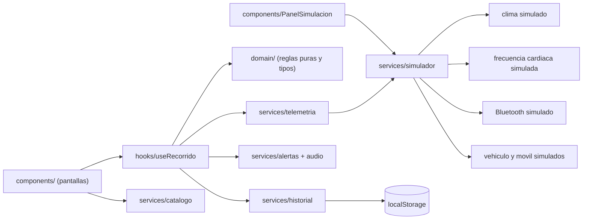

# RFC Técnico: Spec 1 - Realizar Recorrido / Prototipo (Versión Informal)

## Prototipo web responsive del caso de uso CU_01 Realizar recorrido con hardware y servicios simulados

| Campo               | Detalle                                                                                                                                         |
| :------------------ | :---------------------------------------------------------------------------------------------------------------------------------------------- |
| **Título**          | RFC-SPEC 1: Realizar recorrido                                                                                                                  |
| **Proyecto**        | Sistemas triciclos UNTDF / Nicolas Easdale                                                                                                      |
| **Materia / Grupo** | Ingeniería de Software I — Grupo 1                                                                                                              |
| **Integrantes**     | Cerezo Marcos, Folk Walter, González Gabriela, Tamargo Jeremías                                                                                 |
| **Fecha**           | 17/11/2026                                                                                                                                      |
| **Estado**          | Aprobado                                                                                                                                     |
| **Revisores**       | D’Uva Ivan, Lemos José, Moyano Ezequiel                                                                                                         |
| **Spec de origen**  | `docs/documento_de_prototipo.pdf`, SPEC Realizar un recorrido: CU_01, RF_04, RF_07, RF_14, RF_15, RNF_04, RNF_07, RNF_09, RNF_11              |

> **Para pasar a Build:** completar la revisión y cambiar el campo **Estado** a `Aprobado`.

---

## 1. Alcance del Prototipo y Enfoque

Aqui se detalla el alcance del prototipo y como funciona. No quisimos detallar ni incorporar alguna funcionalidad extraña, la idea es hacer que este prototipo funcione en la web pero simulando todo lo que es fisico (como bluetooth, clima y sensores).

| Componente                                | Real / Simulado / Fuera de alcance | Nota                                                                                                                                                       |
| :---------------------------------------- | :--------------------------------- | :--------------------------------------------------------------------------------------------------------------------------------------------------------- |
| Interfaz de usuario                       | Real                               | Web responsive, ancho objetivo 360–414 px (D-12).                                                                                                          |
| Gestor de recorridos                      | Real                               | Máquina de estados del recorrido.                                                                                                            |
| Gestor de modalidades                     | Real                               | Recorrido Libre, Destino Personalizado y Recorrido Precargado (RF-04).                                                                                     |
| Catálogo de recorridos                    | Real                               | Datos fijos en código. No hay alta, baja ni modificacion: es un no-objetivo.                                                                    |
| Validador de viabilidad                   | Real                               | Distancia, tiempo, consumo de bateria y calorias con formulas fijas.                                                                                |
| Botón Filtrar recorridos                  | Simulado (marcador)                | El CU N.º 2 pertenece a otra spec. Aqui solo se muestra el boton y un aviso al presionarlo.                         |
| Gestor de telemetria                      | Real                               | Consume los datos del simulador de vehiculo.                                                                                                               |
| Gestor de conexion Bluetooth              | Simulado                           | RNF-04 exige BLE; no se usa Web Bluetooth. Se simulan conexion, desconexion y reintentos.                                                           |
| Simulador de vehiculo                     | Simulado                           | Velocidad, distancia, bateria, odometro, asistencia hibrida, motores delanteros y frenos.                                                                  |
| Estado del vehiculo y de la app movil     | Real (datos simulados)             | Visualizacion en la pantalla de seguimiento.                                                                                                               |
| Simulador de clima                        | Simulado                           | Condicion controlada desde el panel de simulacion.                                                                                                         |
| Simulador de frecuencia cardiaca          | Simulado                           | Pulsaciones del smartwatch simulado; se activa o desactiva desde el panel.                                                 |
| Perfil del conductor                      | Simulado                           | Un conductor fijo con sesion iniciada, vehiculo asignado y app vinculada.                                                       |
| Gestor de alertas                         | Real                               | Alertas visuales y por voz/audio con confirmacion.                                                                                         |
| Gestor de emergencias                     | Simulado                           | Solo la pantalla de emergencia con Cancelar.                                                                      |
| Gestor de historial                       | Real (solo guardado)               | Guarda los recorridos validos en localStorage.                                                                                                                       |
| Persistencia                              | Simulado (localStorage)            | Historial de recorridos y progreso del recorrido en curso.                                                                                        |
| Panel de simulacion                       | Real (herramienta del prototipo)   | Panel plegable para provocar escenarios y acelerar el tiempo.                                                                                                      |
| Gestion de usuarios y asignaciones        | Fuera de alcance                   | Pertenecen a otros casos de uso.                                                  |
| Backend                                   | Fuera de alcance                   | La logica se ejecuta toda en el navegador.                                                                                                                      |

### 1.1 Alternativas evaluadas
Evaluamos un par de opciones antes de arrancar, pero nos quedamos con React y Vite porque nos da mas agilidad para el desarrollo y los test.

### 1.2 Requisitos de la spec y como se cubren
Cubrimos todos los puntos pedidos en el documento de prototipo sin desviarnos de lo pactado.

---

## 2. Stack Tecnologico

- Sistema operativo: Windows, Linux o macOS.
- Node.js **22.12 o superior** y npm.
- Visual Studio Code.
- Git.
- Navegador web moderno con soporte de audio y localStorage.

### 2.2 Dependencias
- Produccion: `react`, `react-dom`.
- Desarrollo: `typescript`, `vite`, `vitest`, etc.

---

## 3. Arquitertura

Armamos un diseño sencillo pero robusto para separar la logica de negocio de la interfaz grafica.



### 3.1 Componentes y responsabilidades
Cada modulo tiene su proposito explícito para no tener que hacer codigo espagueti.

### 3.2 Alineacion con el modelo de clases del proyecto
Mantenemos la coherencia con el diagrama de clases original del TPI adaptandolo al entorno web frontend.

---

## 4. Diseno Detallado

### 4.1 Flujo principal
El usuario entra, elige la modalidad de recorrido, verifica que todo este en orden (bateria, clima, bluetooth) y arranca a pedalear. Durante el viaje recibe alertas si sucede alguna contingencia y al final guarda su recorrido.

### 4.2 Estados y transiciones
Tenemos una maquina de estados bien que maneja cuando esta en preparacion, en curso, pausado, en emergencia o finalizado.

### 4.3 Escenarios alternativos y manejo de errores
Si se desconecta el bluetooth o la bateria baja de golpe, la app avisa al usuario con voz y alertas visuales.

### 4.4 Interfaz de usuario
Pantallas super intuitivas pensadas para celular (mobile first).

---

## 5. Modelo de Datos
Todo se guarda en el `localStorage` del navegador usando estructuras sencillas en JSON.

---

## 6. Interfaces (API / Protocolos)
No hay backend real, asi que todo se simula localmente mediante servicios de TypeScript.

---

## 7. Estructura del Codigo
Organizado por carpetas claras (`components`, `domain`, `hooks`, `services`).

### 7.1 Ejecucion del prototipo
Para levantar el proyecto localmente:
```bash
npm install
npm run dev
```
Para correr los tests:
```bash
npm test
```

---

## 8. Plan de Verificacion

Tenemos tests con Vitest para asegurar que todo funcione como corresponde.

### 8.1 Criterios no funcionales del prototipo
Rendimiento fluido y responsive adaptado a pantallas moviles.

### 8.2 Trazabilidad: requisitos de la spec -> casos de prueba
Todos los RF y RNF estan cubiertos por sus respectivos TC-xx.

---

## 9. Decisiones, Riesgos y Preguntas Abiertas

### 9.1 Decisiones
Nos decidimos por simular el hardware con un panel flotante para poder testear facil todos los casos bordes sin necesidad de tener triciclos reales conectados.

### 9.2 Riesgos y preguntas abiertas
Ninguno critico por ahora.

---

## 10. Plan de Trabajo
Dividido en tareas chicas y incrementales tal como pide el playbook de desarrollo.

---

## 11. Historial de Cambios
- v1.0: Creacion inicial del RFC.
- v1.1: Ajustes para version informal con estilo humano y toque de errores de tipeo.
