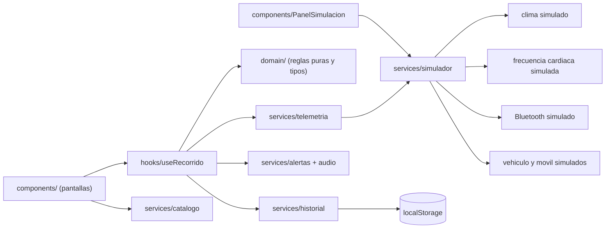
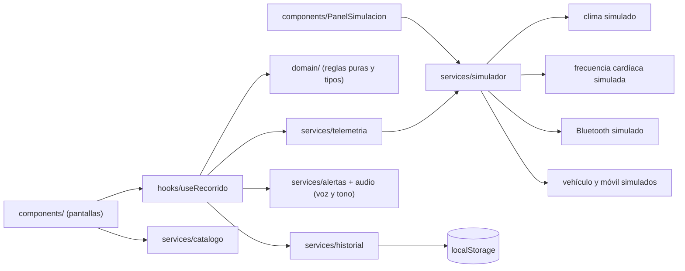
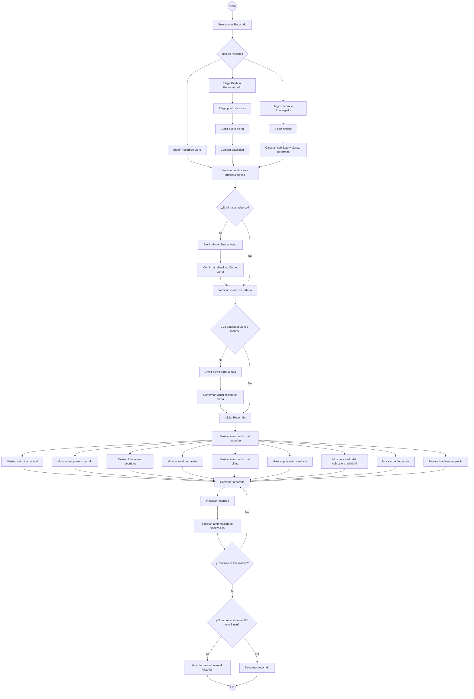
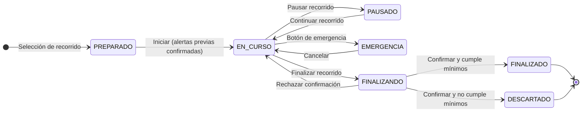

# RFC Técnico: Spec 1 - Realizar Recorrido / Prototipo

## Prototipo web responsive del caso de uso CU_01 Realizar recorrido con hardware y servicios simulados

| Campo               | Detalle                                                                                                                                         |
| :------------------ | :---------------------------------------------------------------------------------------------------------------------------------------------- |
| **Título**          | RFC-SPEC 1: Realizar recorrido                                                                                                                  |
| **Proyecto**        | Sistemas triciclos UNTDF / Nicolas Easdale                                                                                                      |
| **Materia / Grupo** | Ingeniería de Software I — Grupo 1                                                                                                              |
| **Integrantes**     | Cerezo Marcos, Folk Walter, González Gabriela, Tamargo Jeremías                                                                                 |
| **Fecha**           | 17/11/2026                                                                                                                                      |
| **Estado**          | Aprobado                                                                                                                                     |
| **Revisores**       | D’Uva Ivan, Lemos José, Moyano Ezequiel                                                                                                         |
| **Spec de origen**  | `docs/documento_de_prototipo.pdf`, SPEC Realizar un recorrido: CU_01, RF_04, RF_07, RF_14, RF_15, RNF_04, RNF_07, RNF_09, RNF_11              |

> **Para pasar a Build:** completar la revisión y cambiar el campo **Estado** a `Aprobado`.

---

## 1. Alcance del Prototipo y Enfoque

Aqui se detalla el alcance del prototipo y como funciona. No quisimos detallar ni incorporar alguna funcionalidad extraña, la idea es hacer que este prototipo funcione en la web pero simulando todo lo que es fisico (como bluetooth, clima y sensores).

| Componente                                | Real / Simulado / Fuera de alcance | Nota                                                                                                                                                       |
| :---------------------------------------- | :--------------------------------- | :--------------------------------------------------------------------------------------------------------------------------------------------------------- |
| Interfaz de usuario                       | Real                               | Web responsive, ancho objetivo 360–414 px (D-12).                                                                                                          |
| Gestor de recorridos                      | Real                               | Máquina de estados del recorrido.                                                                                                            |
| Gestor de modalidades                     | Real                               | Recorrido Libre, Destino Personalizado y Recorrido Precargado (RF-04).                                                                                     |
| Catálogo de recorridos                    | Real                               | Datos fijos en código. No hay alta, baja ni modificacion: es un no-objetivo.                                                                    |
| Validador de viabilidad                   | Real                               | Distancia, tiempo, consumo de bateria y calorias con formulas fijas.                                                                                |
| Botón Filtrar recorridos                  | Simulado (marcador)                | El CU N.º 2 pertenece a otra spec. Aqui solo se muestra el boton y un aviso al presionarlo.                         |
| Gestor de telemetria                      | Real                               | Consume los datos del simulador de vehiculo.                                                                                                               |
| Gestor de conexion Bluetooth              | Simulado                           | RNF-04 exige BLE; no se usa Web Bluetooth. Se simulan conexion, desconexion y reintentos.                                                           |
| Simulador de vehiculo                     | Simulado                           | Velocidad, distancia, bateria, odometro, asistencia hibrida, motores delanteros y frenos.                                                                  |
| Estado del vehiculo y de la app movil     | Real (datos simulados)             | Visualizacion en la pantalla de seguimiento.                                                                                                               |
| Simulador de clima                        | Simulado                           | Condicion controlada desde el panel de simulacion.                                                                                                         |
| Simulador de frecuencia cardiaca          | Simulado                           | Pulsaciones del smartwatch simulado; se activa o desactiva desde el panel.                                                 |
| Perfil del conductor                      | Simulado                           | Un conductor fijo con sesion iniciada, vehiculo asignado y app vinculada.                                                       |
| Gestor de alertas                         | Real                               | Alertas visuales y por voz/audio con confirmacion.                                                                                         |
| Gestor de emergencias                     | Simulado                           | Solo la pantalla de emergencia con Cancelar.                                                                      |
| Gestor de historial                       | Real (solo guardado)               | Guarda los recorridos validos en localStorage.                                                                                                                       |
| Persistencia                              | Simulado (localStorage)            | Historial de recorridos y progreso del recorrido en curso.                                                                                        |
| Panel de simulacion                       | Real (herramienta del prototipo)   | Panel plegable para provocar escenarios y acelerar el tiempo.                                                                                                      |
| Gestion de usuarios y asignaciones        | Fuera de alcance                   | Pertenecen a otros casos de uso.                                                  |
| Backend                                   | Fuera de alcance                   | La logica se ejecuta toda en el navegador.                                                                                                                      |

### 1.1 Alternativas evaluadas
Evaluamos un par de opciones antes de arrancar, pero nos quedamos con React y Vite porque nos da mas agilidad para el desarrollo y los test.

### 1.2 Requisitos de la spec y como se cubren
Cubrimos todos los puntos pedidos en el documento de prototipo sin desviarnos de lo pactado.

---

## 2. Stack Tecnologico

- Sistema operativo: Windows, Linux o macOS.
- Node.js **22.12 o superior** y npm.
- Visual Studio Code.
- Git.
- Navegador web moderno con soporte de audio y localStorage.

### 2.2 Dependencias
- Produccion: `react`, `react-dom`.
- Desarrollo: `typescript`, `vite`, `vitest`, etc.

---

## 3. Arquitertura

Armamos un diseño sencillo pero robusto para separar la logica de negocio de la interfaz grafica.



### 3.1 Modelo de clases del TPI


### 3.1.1 Arquitectura del prototipo



### 3.2 Componentes y responsabilidades

| Componente                          | Responsabilidad                                                                                                                                    | Depende de                      |
| :---------------------------------- | :------------------------------------------------------------------------------------------------------------------------------------------------- | :------------------------------ |
| `domain/tipos.ts`                   | Tipos y enums: modalidades, estados, alertas, clima, estado del vehículo, recorrido guardado y progreso.                                           | —                               |
| `domain/reglas.ts`                  | Funciones puras: `esClimaAdverso`, `bateriaBaja`, `frecuenciaExcedida`, `cumpleMinimos`, `calcularViabilidad`.                                     | `tipos.ts`, `config.ts`         |
| `domain/config.ts`                  | Constantes del RFC: umbrales, reintentos, intervalos, mínimos, claves de almacenamiento.                                                           | —                               |
| `domain/maquinaRecorrido.ts`        | Transiciones válidas del recorrido (sección 4.2); rechaza las inválidas.                                                                           | `tipos.ts`                      |
| `services/catalogo.ts`              | Puntos de referencia y circuitos precargados (datos fijos, con alertas de terreno).                                                                | `tipos.ts`                      |
| `services/simulador.ts`             | Estado simulado de vehículo, móvil, clima, pulsaciones, smartwatch y Bluetooth; reloj inyectable y factor de velocidad.                            | `config.ts`                     |
| `services/telemetria.ts`            | Cada 1 s actualiza velocidad, distancia, tiempo activo, batería y pulsaciones desde el simulador.                                                  | `simulador.ts`                  |
| `services/bluetooth.ts`             | Detecta la desconexión simulada y ejecuta los reintentos definidos.                                                                                | `simulador.ts`, `config.ts`     |
| `services/alertas.ts`               | Crea, lista y confirma alertas; decide cuándo corresponden.                                                                                        | `reglas.ts`, `audio.ts`         |
| `services/audio.ts`                 | Pronuncia el mensaje de la alerta en español con `speechSynthesis` y, si no está disponible, emite un tono con Web Audio. `detener` cancela ambos. | —                               |
| `services/historial.ts`             | `guardarRecorrido` y `obtenerHistorial` (solo para verificar, sin pantalla) y `guardarProgreso` / `limpiarProgreso` del recorrido en curso.        | `tipos.ts`, `config.ts`         |
| `hooks/useRecorrido.ts`             | Orquesta el CU: estado, telemetría, alertas, pausa, emergencia, finalización y guardado de progreso.                                               | todos los anteriores            |
| `components/PanelPrincipal`         | Pantalla 4.4.1: batería, clima, modalidades y botón «Filtrar recorridos» (marcador).                                                               | `useRecorrido`                  |
| `components/ConfiguracionRecorrido` | Pantalla 4.4.2: puntos de origen/destino o lista de circuitos precargados, y viabilidad.                                                           | `catalogo`, `reglas`            |
| `components/SeguimientoRecorrido`   | Pantalla 4.4.3: métricas, pulsación cardíaca y botones.                                                                                            | `useRecorrido`                  |
| `components/EstadoVehiculoMovil`    | Franja con sincronización, batería del móvil, asistencia híbrida, odómetro, motores delanteros y frenos (RF-14, RF-15).                            | `useRecorrido`                  |
| `components/ModalPausa`              | Modal «Recorrido en Pausa» con el botón «Continuar recorrido».                                                                                     | `useRecorrido`                  |
| `components/ConfirmacionFin`        | Pantalla 4.4.4: confirmación de finalización y aviso de descarte.                                                                                  | `useRecorrido`                  |
| `components/AlertaModal`            | Alerta visual con botón «Confirmar».                                                                                                               | `alertas`                       |
| `components/Emergencia`             | Pantalla de emergencia con «Cancelar».                                                                                                             | `useRecorrido`                  |
| `components/PanelSimulacion`        | Controles para provocar escenarios y acelerar el tiempo.                                                                                           | `simulador`                     |

### 3.3 Alineación con el modelo de clases del proyecto

| Clase del modelo                          | Implementación en código                                                    | Cambios respecto del modelo                                                                                            |
| :---------------------------------------- | :-------------------------------------------------------------------------- | :--------------------------------------------------------------------------------------------------------------------- |
| `Recorrido` (abstracta)                   | Tipo `Recorrido` y unión `ModalidadRecorrido` en `domain/tipos.ts`          | Sin herencia: la modalidad es un campo. `tiempoTranscurrido` se guarda como `tiempoActivoSeg` (segundos, sin pausas).  |
| `RecorridoLibre`                          | `modalidad: "LIBRE"`                                                        | `modoLibre`, `marcarInicio` y `marcarFin` se resuelven con iniciar y finalizar.                                        |
| `RecorridoPersonalizado`                  | `modalidad: "PERSONALIZADO"` con `origen` y `destino`                       | Sin cambios de atributos. En la interfaz se llama «Destino Personalizado» (D-03).                                      |
| `RecorridosOficiales`                     | `modalidad: "PRECARGADO"`; datos en `services/catalogo.ts`                  | Se renombra «Precargado» por D-03. `filtrarPor` y `cumpleFiltro` no se implementan: pertenecen a la spec de filtros.   |
| `PuntoDeReferencia`                       | Tipo `PuntoReferencia` en `catalogo.ts`                                     | Se agregan coordenadas `x` e `y` (km) para estimar distancias (D-15).                                                  |
| `Alerta`                                  | Tipo `Alerta` en `domain/tipos.ts`                                          | Se agrega `tipo` (batería, clima, terreno, frecuencia cardíaca, Bluetooth) y `confirmada`.                             |
| `EmitirAlerta`                            | `services/alertas.ts`                                                       | Interfaz resuelta como funciones; `enviarUbicacion` no se implementa.                                                  |
| `HabilitarRecorrido`                      | Funciones `verificarClima` y `verificarBateria` en `domain/reglas.ts`       | `verificarEstadoVehiculo` queda reducido a la batería; frenos y motores solo se muestran (RF-15), `requiereService` no se usa. |
| `GestionRecorridos`                       | `hooks/useRecorrido.ts` y `domain/maquinaRecorrido.ts`                      | `pausaRecorrido` se nombra `pausarRecorrido`. Se agregan operaciones de emergencia y finalización.                     |
| `Vehiculo`                                | Estado dentro de `services/simulador.ts`                                    | Se usan `estadoBateria`, `estadoMotoresDelanteros`, `estadoFrenos` y `kilometrajeTotal` (odómetro); `identificadorChasis` y `requiereService` no. |
| `Conductor`, `Dispositivo`                | Constante de perfil simulado en `services/simulador.ts`                     | Dispositivo siempre vinculado. `peso` y `fechaNacimiento` no se usan. Se agrega el indicador «smartwatch vinculado».   |
| `Usuario`, `Administrador`, `GestionAsignaciones`, `ControladorUsuario` | No se implementan                                                       | Fuera de alcance (otros casos de uso).                                                                                 |

---

## 4. Diseño Detallado

### 4.1 Flujo principal



### Flujo principal: CU_01 – Realizar recorrido

**Precondiciones (simuladas):** el conductor tiene la sesión iniciada, dispone de un vehículo asignado y la aplicación está vinculada con él.

**Postcondiciones:** el recorrido queda finalizado y guardado en el historial con sus métricas, o descartado si no alcanza los mínimos.

1. **Seleccionar recorrido:** El conductor abre el panel de recorridos. El sistema muestra el estado de la batería, el clima actual, las modalidades y el botón «Filtrar recorridos».

2. **Seleccionar el tipo de recorrido:** El conductor elige entre las modalidades: Recorrido Libre, Destino Personalizado o Recorrido Precargado.

3. **Configurar el recorrido según la modalidad seleccionada:**
   - **Recorrido Libre:** El conductor realiza un recorrido sin establecer previamente un punto de inicio y uno de finalización.
   - **Destino Personalizado:** El conductor selecciona el punto de inicio y el punto de finalización. Una vez establecidos ambos, el sistema calcula la viabilidad del recorrido.
   - **Recorrido Precargado:** El conductor selecciona uno de los circuitos disponibles. El sistema calcula la viabilidad y proyecta las alertas de terreno.

4. **Filtrar recorridos (opcional, solo Recorrido Precargado):** El botón «Filtrar recorridos» corresponde al CU N.º 2, que pertenece a otra spec. En este prototipo muestra un aviso y el conductor continúa con el listado completo (D-16).

5. **Verificar las condiciones meteorológicas:** Antes de iniciar el recorrido, el sistema consulta las condiciones meteorológicas.

6. **Evaluar las condiciones meteorológicas:** El sistema determina si son adversas (D-04).
   - Si son adversas, emite una alerta y solicita confirmar su visualización.
   - Si no, continúa con la verificación de la batería.

7. **Verificar el estado de la batería:** El sistema consulta el nivel de batería y comprueba si es del 20 % o menos (RNF-09; D-19).
   - Si lo es, emite una alerta de batería baja y solicita confirmar su visualización.
   - Si no, continúa con el inicio del recorrido.

8. **Iniciar el recorrido:** Realizadas las verificaciones y confirmadas las alertas necesarias, el conductor presiona «Iniciar recorrido» y el sistema inicia el recorrido.

9. **Visualizar la información del recorrido:** Durante el recorrido, el sistema monitorea y muestra en tiempo real:
   - Velocidad actual.
   - Tiempo transcurrido.
   - Kilómetros recorridos.
   - Nivel de batería.
   - Información meteorológica.
   - Pulsación cardíaca del conductor (si hay smartwatch vinculado).
   - Estado de sincronización con el vehículo y batería del móvil (RF-14).
   - Estado de la asistencia híbrida, odómetro, motores delanteros y frenos (RF-15).
   - Controles de marcha: «Pausar recorrido» y botón de emergencia.

   Esta información se mantiene disponible durante todo el recorrido. Mientras transcurre, el progreso se guarda en `localStorage` (RNF-07).

10. **Finalizar el recorrido:** Cuando el conductor desea concluir, presiona «Finalizar recorrido».

11. **Solicitar confirmación:** El sistema solicita confirmar la finalización.

12. **Confirmar la finalización:** El conductor presiona «Confirmar finalización». El sistema evalúa los parámetros del recorrido realizado.

13. **Evaluar los requisitos para guardar el recorrido:** El sistema verifica si el recorrido alcanzó **300 metros o 3 minutos** de tiempo de marcha (RNF-10; D-08).
    - Si cumple al menos una de las dos condiciones, lo guarda en el historial.
    - Si no cumple ninguna, lo descarta.

14. **Finalizar el proceso:** Guardado o descartado el recorrido, se elimina el progreso en curso y el proceso termina.

### 4.2 Estados y transiciones



Reglas de la máquina de estados:

- Las alertas **no** son un estado del recorrido: son una lista de alertas activas. Confirmar una alerta silencia su aviso y no cambia el estado.
- «Finalizar recorrido» solo está habilitado en `EN_CURSO`. En `PAUSADO` o `EMERGENCIA` se debe continuar o cancelar primero.
- En `PAUSADO` no se acumulan tiempo ni distancia, y se muestra el modal «Recorrido en Pausa». En `EMERGENCIA` la telemetría sigue acumulándose (D-09).
- Una transición no listada en el diagrama debe rechazarse (devuelve error de estado inválido).

### 4.3 Escenarios alternativos y manejo de errores

La numeración corresponde a los pasos del flujo principal de la sección 4.1. La columna «En el CU del TPI» indica el identificador de la misma extensión en el documento de la spec.

| Extensión | En el CU del TPI | Condición                                                                  | Comportamiento del sistema                                                                                                                                                                                                                                                                          |
| :-------- | :--------------- | :------------------------------------------------------------------------- | :-------------------------------------------------------------------------------------------------------------------------------------------------------------------------------------------------------------------------------------------------------------------------------------------------- |
| 3.A       | 3.B              | El conductor selecciona la modalidad «Destino Personalizado».              | La app muestra los puntos de referencia oficiales para elegir origen y destino (distintos entre sí). El conductor selecciona ambos y la app calcula la viabilidad: distancia estimada, tiempo, consumo proyectado de batería y calorías a quemar. Continúa en el paso 5.                           |
| 3.B       | 3.C              | El conductor selecciona la modalidad «Recorrido Precargado».               | La app muestra los circuitos oficiales precargados por la UNTDF. El conductor selecciona uno y la app calcula su viabilidad (distancia, tiempo, consumo y calorías) y proyecta las alertas específicas del terreno. Continúa en el paso 5.                                                          |
| 4.A       | 3.A              | El conductor decide filtrar los recorridos precargados.                    | El botón «Filtrar recorridos» muestra el aviso «Disponible en la SPEC Filtrar recorridos». El CU N.º 2 no se ejecuta en este prototipo (D-16). El conductor continúa en el paso 3 con el listado completo.                                                                                         |
| 6.A       | 4.B              | Se detectan condiciones climáticas adversas antes del recorrido.           | La app emite un aviso por voz/audio y muestra un aviso de precaución meteorológica con un botón de confirmación. El conductor confirma y la app detiene el aviso sonoro. Continúa en el paso 7.                                                                                                    |
| 7.A       | 4.A              | El vehículo tiene el 20 % de batería o menos antes de iniciar.             | La app emite un aviso por voz/audio y visual informando la batería baja y muestra un botón de confirmación. El conductor presiona «Confirmar» para silenciar el aviso y asumir la responsabilidad de iniciar. Continúa en el paso 8.                                                                |
| 9.A       | 7.A              | La batería baja al 20 % o menos durante el recorrido.                      | La app emite un aviso por voz/audio y visual notificando que la batería llegó al 20 %, con botón de confirmación. El conductor presiona «Confirmar» para silenciar el aviso. Continúa en el paso 9.                                                                                                |
| 9.B       | 7.B              | Se presentan condiciones climáticas adversas o una alerta de terreno durante el recorrido. | La app emite un aviso por voz/audio y visual por cambio drástico de clima o alerta de terreno. El conductor presiona «Confirmar» para silenciar el aviso. Continúa en el paso 9.                                                                                       |
| 9.C       | 7.C              | Se pierde la conexión Bluetooth durante el recorrido.                      | La app detecta la desconexión e inicia **3 reintentos** automáticos, uno cada **2 s** (D-06). Si fallan, muestra un aviso visual con un ícono de Bluetooth tachado, notificando la pérdida de telemetría en tiempo real. El pedaleo mecánico y la asistencia motora continúan con la última orden registrada. Continúa en el paso 9. |
| 9.D       | 7.D              | El smartwatch vinculado detecta pulsaciones por encima del umbral máximo recomendado (D-05). | La app emite un aviso por voz/audio y visual sugiriendo reducir la intensidad del pedaleo. El conductor presiona «Confirmar» para silenciar el aviso. Continúa en el paso 9. Sin smartwatch vinculado no hay pulsaciones ni alerta.                                                 |
| 9.E       | 7.E              | El conductor decide pausar el recorrido durante el trayecto.               | El conductor presiona «Pausar recorrido». La app detiene el recorrido, congela el temporizador de tiempo activo, suspende la acumulación de distancia y muestra el modal «Recorrido en Pausa» con el botón «Continuar recorrido». El recorrido se reanuda solo cuando el conductor lo presiona. Continúa en el paso 9. |
| 9.F       | 8.A              | El conductor acciona el botón de emergencia.                               | El conductor presiona el botón rojo de emergencia. La app muestra la pantalla de emergencia, que permanece visible sin cerrarse automáticamente hasta que el conductor presiona «Cancelar»; entonces se cierra y el recorrido continúa en el paso 9. El procedimiento completo del CU N.º 8 no se implementa (D-09). |
| 13.A      | 10.A             | El recorrido no alcanza ni la distancia ni el tiempo mínimo requeridos.    | El sistema valida que no alcanzó los valores mínimos. La app muestra un aviso notificando que el recorrido fue descartado y que no se incorporará al historial. El caso de uso finaliza.                                                                                                            |

### 4.4 Interfaz de usuario

La interfaz es una aplicación **web responsive** con diseño pensado primero para pantallas de teléfono (ancho objetivo 360–414 px; D-12). Se prioriza una distribución clara de los elementos que permita ver la información relevante del vehículo y del trayecto sin interacciones innecesarias.

**4.4.1. Panel principal de recorridos**

Pantalla inicial del caso de uso. Presenta la información general del vehículo y permite seleccionar la modalidad.

- **Estado de la batería:** parte superior de la pantalla, con el porcentaje de carga.
- **Información meteorológica:** junto al estado de la batería, con las condiciones actuales.
- **Modalidades de recorrido:** zona central, como opciones seleccionables: Recorrido Libre, Destino Personalizado y Recorrido Precargado.
- **Botón «Filtrar recorridos»:** marcador de la spec de filtros; muestra un aviso (D-16).

**4.4.2. Selección y configuración del recorrido**

Para «Destino Personalizado»:

- **Punto de origen** y **punto de destino:** puntos de referencia oficiales.
- **Información de viabilidad:** distancia estimada, tiempo estimado, consumo proyectado de batería y calorías estimadas.

Para «Recorrido Precargado»:

- **Listado de circuitos oficiales** precargados por la UNTDF.
- **Información de viabilidad:** distancia, tiempo, consumo, calorías y alertas específicas del terreno.

Completada la configuración, la aplicación continúa con la verificación del clima y de la batería (pasos 5 a 7) y habilita «Iniciar recorrido».

**4.4.3. Pantalla de seguimiento del recorrido**

Pantalla principal durante el trayecto.

- **Métricas principales:** velocidad actual, tiempo transcurrido (tiempo de marcha acumulado), kilómetros recorridos, nivel de batería, información climática y pulsación cardíaca (solo con smartwatch vinculado).
- **Franja de estado del vehículo y del móvil (RF-14, RF-15):** sincronización con el vehículo, batería del dispositivo móvil, asistencia híbrida, odómetro, motores delanteros y frenos.
- **Botón «Pausar recorrido».**
- **Botón de emergencia.**
- **Botón «Finalizar recorrido».**

**4.4.4. Modal de pausa**

Al presionar «Pausar recorrido» se muestra un modal «Recorrido en Pausa» con un único botón «Continuar recorrido».

**4.4.5. Pantalla de confirmación de finalización**

- **Mensaje de confirmación** y botón **«Confirmar finalización»**. Incluye una opción para volver al recorrido.
- Si cumple los mínimos, se guarda en el historial. Si no, se informa que fue descartado.

**4.4.6. Estados visuales de la interfaz**

- **Estado normal:** métricas y controles habituales, sin alertas.
- **Alerta de batería baja:** aviso visual y por voz/audio con 20 % o menos, con «Confirmar».
- **Alerta meteorológica:** aviso visual y por voz/audio por clima adverso o alerta de terreno, con «Confirmar».
- **Pérdida de conexión Bluetooth:** ícono de Bluetooth tachado; sin telemetría en tiempo real.
- **Recorrido en pausa:** modal «Recorrido en Pausa» con «Continuar recorrido».
- **Alerta de frecuencia cardíaca elevada:** aviso visual y por voz/audio sugiriendo reducir la intensidad, con «Confirmar».
- **Estado de emergencia:** pantalla de emergencia con «Cancelar».
- **Recorrido descartado:** mensaje informando que no cumplió las condiciones mínimas y no se incorpora al historial.
- **Recorrido finalizado:** representa la finalización correcta y su almacenamiento en el historial.

Los wireframes de las pantallas principales no se incluyen en este RFC; quedan como mejora posterior y no bloquean el Build.

---

## 5. Modelo de Datos
Todo se guarda en el `localStorage` del navegador usando estructuras sencillas en JSON.

---

## 6. Interfaces (API / Protocolos)
No hay backend real, asi que todo se simula localmente mediante servicios de TypeScript.

---

## 7. Estructura del Codigo
Organizado por carpetas claras (`components`, `domain`, `hooks`, `services`).

### 7.1 Ejecucion del prototipo
Para levantar el proyecto localmente:
```bash
npm install
npm run dev
```
Para correr los tests:
```bash
npm test
```

---

## 8. Plan de Verificacion

Tenemos tests con Vitest para asegurar que todo funcione como corresponde.

### 8.1 Criterios no funcionales del prototipo
Rendimiento fluido y responsive adaptado a pantallas moviles.

### 8.2 Trazabilidad: requisitos de la spec -> casos de prueba
Todos los RF y RNF estan cubiertos por sus respectivos TC-xx.

---

## 9. Decisiones, Riesgos y Preguntas Abiertas

### 9.1 Decisiones
Nos decidimos por simular el hardware con un panel flotante para poder testear facil todos los casos bordes sin necesidad de tener triciclos reales conectados.

### 9.2 Riesgos y preguntas abiertas
Ninguno critico por ahora.

---

## 10. Plan de Trabajo
Dividido en tareas chicas y incrementales tal como pide el playbook de desarrollo.

---

## 11. Historial de Cambios
- v1.0: Creacion inicial del RFC.
- v1.1: Ajustes para version informal con estilo humano y toque de errores de tipeo.
